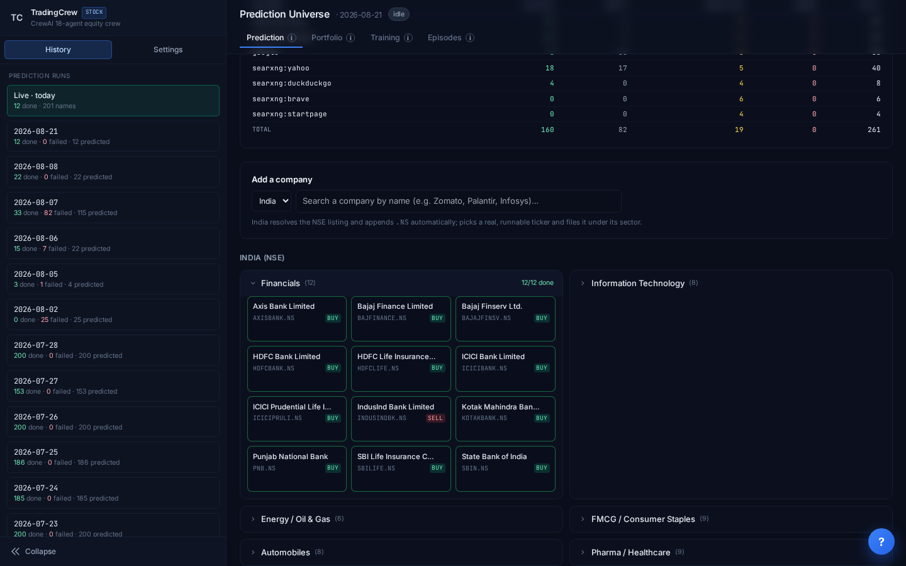
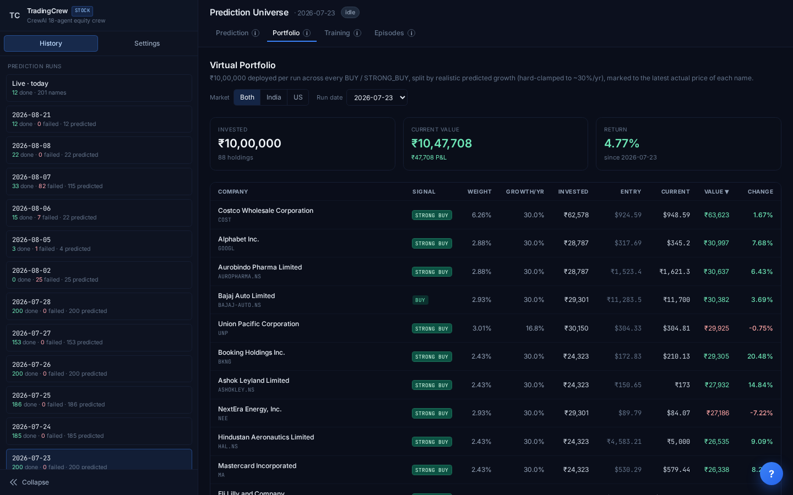
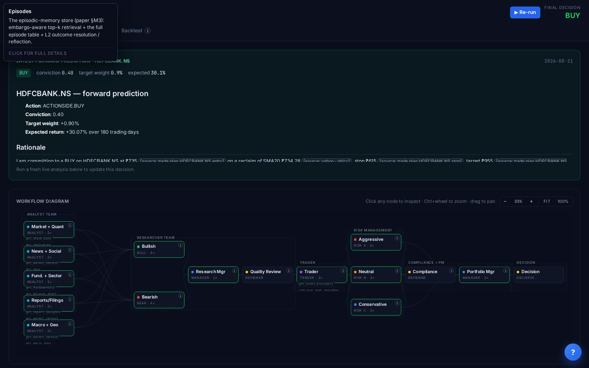
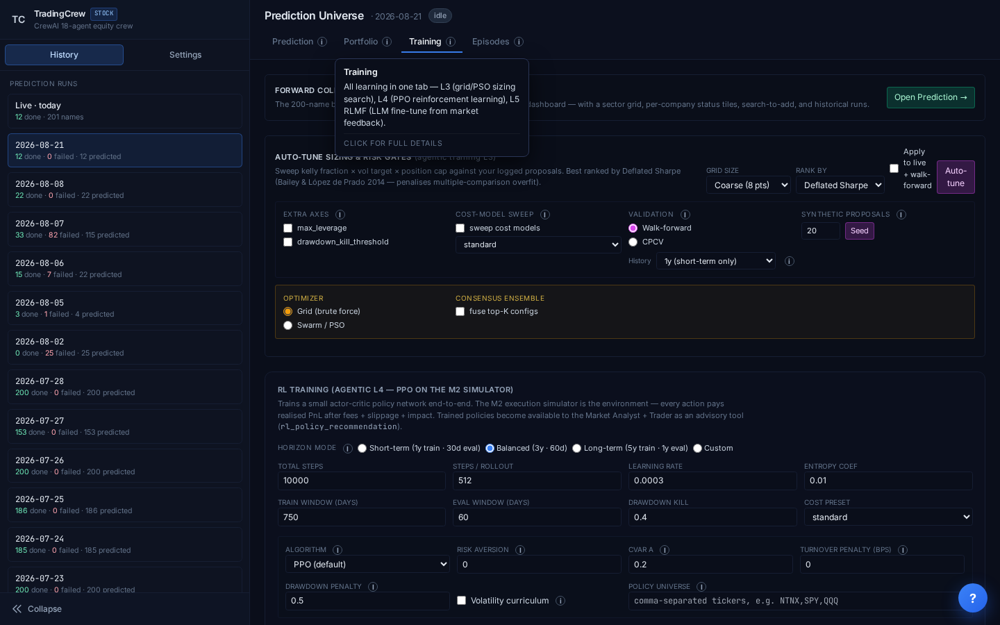

<div align="center">

# TradingCrew

### Multi-agent **stock + commodity** research in a multi-page UI, with a deterministic risk engine after the LLM.

A team of specialist LLM agents debates a trade idea; the verdict then runs through auditable, code-only modules for sizing, risk gates, stop/target sanity, execution simulation, and backtesting — so the *narrative* is the LLM's, but the *numbers* are pure code.

[](LICENSE)
[](requirements.txt)
[](https://docs.crewai.com)
[](docs/README.md)

</div>

---

## Features

- **Multi-page Alpine SPA** — one shell (`web/frontend/index.html`) driven by the URL: landing chooser → high-level stock/commodity dashboards → focused per-instrument workbench. History, Settings, and Help live in the left pane on the high-level pages.
- **Prediction tab** (`/stocks`) — 100 IN + 100 US names as a sector grid; search-to-add; Kafka-backed batch Start / Pause / Resume / Kill. Tile colour is the live session (orange = in flight, green = done). Click a tile → `/run/{TICKER}` with the Workflow diagram streaming.
- **Portfolio tab** — a ₹10L virtual paper book: every `BUY` / `STRONG_BUY` of a run date, capital split by capped predicted growth, marked to the latest real close (USD names get a USD→INR overlay). India / US / All filters re-deploy the full notional inside that market.
- **Training + Episodes** — Hermes (prompts / topology / size) and L3 Apply on Training; embargo-aware retrieval and Resolve on Episodes. L4 PPO is not on the live prediction path.
- **Commodity dashboard** (`/commodity`) — Contracts picker (energy / metals / grains / …) plus Training / Episodes; open a contract → `/commodity/run/{CL=F}` with Workflow · Charts · Futures · Backtest. Prediction / Portfolio are stock-only.
- **Pick your model in the UI** — hosted vLLM, local vLLM, OpenAI, or Anthropic, switchable per run.
- **India-first data path** — `.NS` / `.BO` tickers can route through **screener.in** + **upstox v3** for fundamentals, shareholding, and exchange-clean OHLCV; US filings go through **SEC EDGAR**.
- **Three stock orchestrators** — Settings **Run mode** (also sent on Prediction batch): **Autonomous** is LangGraph (analysts fan out onto a blackboard, debate can re-enter after `request_evidence` or a desk-split / `STANCE: MIXED` extra round, Neutral may reopen the trader). **Deterministic** is the v2 CrewAI pipeline (same LTR diagram and crew wiring as port 8001). **Harness** is a new conductor loop: it picks tools and parallel sub-agents from a high-level goal, queries an operator-fed book corpus plus live web, and must emit independent SHORT / MEDIUM / LONG forecasts before the PM writes one primary ticket. Spawned desks use harness remits (they pick their own tools; no debate/risk-round quota). Quality Review / Compliance, when checked, run on autonomous/deterministic and are packed into the PM. Commodity stays sequential. M1–M7 stay outside every LLM path. A HOLD keeps `size_pct_of_book=0` but the risk layer fills ATR watch stop/target and a recommended Kelly/vol size (not a live order).
- **Hermes prediction harness** — after Resolve, Hermes scores the 30-day book vs `desk_strategy.yaml` and opens **one** experiment from evidence (hurt-desk `recommended_change` → desk prompt; split boards → extra debate; hit-rate OK but alpha/DD fail → size; wrong side → more debate). Apply path is unchanged (`apply_harness` + graph router). Mass 1PO/2TO/`promote_graph.py` stay **legacy** for later A/B; they are not the live training step. One LOSS never rewrites production.
- **Lean debate, then code** — 5 analyst desks (Market, News, Fundamentals, Reports, Macro) → bull/bear → research manager → trader → risk → PM. Default run is ~11 agents; Quality Review / Compliance are opt-in on both modes; CrewAI memory is sequential-only (Deterministic / commodity). After the LLM: bridge → simulator → critic (advisory) → Kelly/vol/CVaR sizer + hard gates → walk-forward backtest → allocator, with volatility-grounded stops and staged T1/T2/T3 targets. A **signal-alignment guard** holds the tile when desks split (`TRADINGCREW_PM_ALIGN_GUARD`).
- **Feedback is Resolve** — generate signal by running predictions, then Resolve (30-day and/or thesis). The tape labels WIN/LOSS vs the predicted side; hurt-desk `recommended_change` (when Resolve wrote one) can open a desk-prompt experiment. L3 grid/PSO stays on the Training tab and sizes with Hermes; L4 PPO is not live. Round-1 bull/bear argue in parallel off a shared evidence blackboard and may queue at most two `request_evidence` re-queries.
- **Self-learn on a 30-day clock** — each decision still carries a SHORT / MEDIUM / LONG thesis, but the harness prices a **30-calendar-day review** (~21 trading sessions) against explicit success/failure bars in the editable [`trading_crew/config/desk_strategy.yaml`](trading_crew/config/desk_strategy.yaml). One LOSS never rewrites production; the loop changes **one knob at a time** and rejects look-ahead-suspect books. MEDIUM/LONG predictions stay on the card and resolve later.
- **Refresh-safe sessions** — queue many tickers; the server owns the run, not the browser tab.
- **Prediction API** (`/api/v1`) — start / status / stop / result over HTTP without the UI. Request sends `ticker` + debate/risk rounds; other knobs live in [`trading_crew/config/api_run.yaml`](trading_crew/config/api_run.yaml). OpenAPI at `/docs`.

## v3 vs v2 (A/B)

This tree is **agentic_workflow_v3**. Leave **v2** running on **port 8001** as the sequential control. v3 listens on **8002** and shares `TRADINGCREW_CACHE_DIR` / `prediction.db` so resolved episodes teach both. Do not start v3 on 8001.

| | v2 (`agentic_workflow_v2`) | v3 (this package) |
| --- | --- | --- |
| UI | http://localhost:8001 | http://localhost:8002 |
| Stock orchestrator | CrewAI `Process.sequential` | Triple: LangGraph **autonomous** (default), **deterministic** = this v2 crew, or **harness** = conductor observe/dispatch loop; same `run_mode` on single run and batch |
| PM evidence | CrewAI `Task.context` = all 5 analyst reports + risk | same reports + thesis + plan + risk stuffed into the isolated PM node (one-task Crews have no implicit context) |
| News / geo queries | country + industry seed maps | analyst writes `query=` from role + `get_market_context` facts + blackboard gap (no industry phrasebook) |
| Sector peers | per-ticker dictionary (`NTNX→DELL/HPE`, `MAZDOCK→COCHINSHIP/…`) | live Yahoo industry + country screen; desk may pass `peers=` from filings (no ticker dictionary) |
| Training | WIN/LOSS + playbook credit | Hermes evidence-selected experiment; legacy Mass promote still available |
| Commodity | sequential | sequential (unchanged) |

Legacy Mass promote (optional A/B): `.venv/bin/python scripts/promote_graph.py --current-version <tag> --candidate-version <tag>`.

## Web UI

Open <http://localhost:8002> after `./run_web.sh`. Routes are served by [`web/backend/app.py`](web/backend/app.py); the SPA reads `window.location.pathname` in [`web/frontend/app.js`](web/frontend/app.js).

| URL | What you see |
| --- | --- |
| `/` | Landing chooser ([`homepage.html`](web/frontend/homepage.html)) — Stock vs Commodity |
| `/stocks` | Live stock dashboard: **Prediction · Training · Episodes** + History pane |
| `/stocks/history/{date}` | Prediction-run review: **Names · Portfolio**. Click a name → `/run/{TICKER}?date=` |
| `/run/{TICKER}` | Focused workbench: **Workflow · Charts · Backtest** (no left pane; Back → the run or Stocks) |
| `/commodity` | Commodity dashboard: **Contracts · Training · Episodes** |
| `/commodity/run/{CL=F}` | Focused futures workbench (+ **Futures** tab: curve / COT / seasonality) |

`/stock`, `/predict`, and `/predict/history/{date}` **307-redirect** to the `/stocks` URLs.

Persistence for the prediction universe, daily results, run history, episodes, and search stats is one SQLite file (`~/.trading_crew/prediction.db`) owned by [`web/backend/prediction_db.py`](web/backend/prediction_db.py). The Portfolio tab is a read-side derivation of that store — [`web/backend/vportfolio.py`](web/backend/vportfolio.py). Batch collect is [`web/backend/scale_runner.py`](web/backend/scale_runner.py) over Kafka (`POST /api/scale/*`).

## Prediction API

The same process that serves the UI (`./start.sh` → **8002**) also exposes a versioned HTTP API. OpenAPI lives at <http://localhost:8002/docs>. The UI Settings page is unchanged; this is the non-browser path.

The request body is only the per-call knobs. Everything else is read from [`trading_crew/config/api_run.yaml`](trading_crew/config/api_run.yaml) (override the file with `TRADINGCREW_API_CONFIG`). Agent / task copy stays in the existing prompt files — it is not inlined on the request:

| File | What it is |
| --- | --- |
| [`trading_crew/config/api_run.yaml`](trading_crew/config/api_run.yaml) | run mode, tools, LLM preset, quality/compliance/critic/fusion |
| [`trading_crew/config/agents.yaml`](trading_crew/config/agents.yaml) | desk personas (role / goal / backstory) |
| [`trading_crew/config/tasks.yaml`](trading_crew/config/tasks.yaml) | task descriptions |
| [`trading_crew/config/run_mode_prompts.yaml`](trading_crew/config/run_mode_prompts.yaml) | autonomous / deterministic / harness contracts |
| [`trading_crew/config/harness.yaml`](trading_crew/config/harness.yaml) | harness budgets, allowlist, standing rules, corpus path |
| `$TRADINGCREW_CACHE_DIR/v3/prompt_overlay.yaml` | optional Settings-page overlays |

Stock identifier is **`ticker`** (e.g. `NTNX`, `RELIANCE.NS`), not a CRM opportunity id.

| Method | Path | Purpose |
| --- | --- | --- |
| `GET` | `/api/v1/health` | process up, LLM env present, config file present |
| `GET` | `/api/v1/config` | resolved knobs + prompt-file paths |
| `POST` | `/api/v1/runs` | start: `{ticker, debate_rounds?, risk_rounds?, force_rerun?}` (rounds required unless `run_mode: harness`) |
| `GET` | `/api/v1/runs` | live / recently-finished sessions |
| `GET` | `/api/v1/runs/{run_id}` | status (in-memory first, then `prediction.db`) |
| `POST` | `/api/v1/runs/{run_id}/stop` | cancel queued or running |
| `GET` | `/api/v1/runs/{run_id}/result` | lite decision + report stubs when persisted |
| `GET` | `/api/v1/runs/{run_id}/reports?role=` | full agent write-up |

```bash
curl -sS http://localhost:8002/api/v1/health
curl -sS http://localhost:8002/api/v1/config
curl -sS -X POST http://localhost:8002/api/v1/runs \
  -H 'Content-Type: application/json' \
  -d '{"ticker":"NTNX","debate_rounds":2,"risk_rounds":1}'
curl -sS http://localhost:8002/api/v1/runs/<run_id>
curl -sS -X POST http://localhost:8002/api/v1/runs/<run_id>/stop
```

Set `run_mode: harness` in [`api_run.yaml`](trading_crew/config/api_run.yaml) (or the UI radio) to use the conductor loop. Loop, session, tools, and desk skills compose from [`harness_plugins.yaml`](trading_crew/config/harness_plugins.yaml). The conductor picks the next desk and a short gap; `planner.spawn_v1` writes a full child instruction (assignment, constraints, stale priors to re-check, verify, return-to-parent) from the live coverage board and that skill. That contract **leads** the child task (CrewAI logs no longer open on the one-line “Investigate {ticker} through your assigned lens”); the YAML remit in [`run_mode_prompts.yaml`](trading_crew/config/run_mode_prompts.yaml) stays as standing desk text. Finish is gated on market, news, fundamentals, macro, filings, a bundled debate (`desk=debate`), and a bundled risk debate (`desk=risk`). Opening debate is `desk=debate` (bull+bear, one crew); opening risk is `desk=risk` (aggressive+conservative+neutral, two rounds: opinion then debate). Separate wings stay spawnable after that. If `max_steps` is spent without a gated finish, `exhaust_steps` closing conductor turns write a ticket from the desks that already ran (HOLD when they conflict, with that conflict in the rationale) instead of a canned size-0 stub. Book ingest reads `corpus_dir` from [`harness.yaml`](trading_crew/config/harness.yaml); override the file with `TRADINGCREW_HARNESS_CONFIG`. Optional operator memory: `TRADINGCREW_HARNESS_MEMORY` (error if set and missing).

LLM URLs, cache dir, concurrency, and the web bind address stay in `.env` (`VLLM_LLM_*` / `LOCAL_LLM_*`, `TRADINGCREW_CACHE_DIR`, `TRADINGCREW_MAX_CONCURRENT_RUNS`, `TRADINGCREW_WEB_HOST` / `TRADINGCREW_WEB_PORT`). Interactive UI routes (`/api/sessions`, `/api/scale/*`) remain for the dashboard.

The full page/tab contract (including why Prediction / Names / Portfolio are hidden on commodity) is in [docs/README.md — hierarchical multi-page UI](docs/README.md#run-it-from-the-dashboard--hierarchical-multi-page-ui).

## Screenshots

|  |  |
| --- | --- |
| **Prediction** — 200-name sector grid; tile colour is the live session | **Portfolio** — ₹10L paper book, marked to the latest close |
|  |  |
| **Workbench** — `/run/{TICKER}`: decision card + agent diagram | **Training** — L3 grid/PSO, L4 PPO |
|  |  |

## Quick start

Python **3.10+**, plus Docker if you want Kafka/Redpanda and SearXNG (recommended for batch / web-search).

**Do not copy a `.env` from another machine.** Git ignores `.env`. Keys, tokens, and Gemini service-account material live only there. On a new host, copy the template and fill your own values:

```bash
python -m venv .venv
.venv/bin/pip install -r requirements.txt

cp .env.example .env       # set VLLM_LLM_* (or LOCAL_LLM_*) at minimum
# also set REPORT_PROCESS_BASE_URL / MODEL / API_KEY for get_report_insights

.venv/bin/python scripts/check_setup.py

# Kafka + SearXNG on the host network (app still runs locally):
docker compose up -d redpanda redpanda-console searxng
# equivalently:  scripts/redpanda.sh start && scripts/searxng.sh start

./run_web.sh               # http://localhost:8002
# or background: ./start.sh   /   ./stop.sh
# v2 control stays on 8001 — do not reuse that port here.
```

Landing page → **Stock Trading** → Prediction tab. For a single-name CLI run: `.venv/bin/python main.py <TICKER>`.

**Minimum `.env`:** `VLLM_LLM_BASE_URL`, `VLLM_LLM_MODEL`, `VLLM_LLM_API_KEY` (or the `LOCAL_LLM_*` block) plus `REPORT_PROCESS_BASE_URL` / `REPORT_PROCESS_MODEL` / `REPORT_PROCESS_API_KEY` for filings. Desk switch is `TRADINGCREW_LLM_PRESET` (`local-vllm` or `hosted-vllm`). Web search works without Tavily if SearXNG is up; set `TAVILY_API_KEY` only if you want that paid backend. Indian tickers need `UPSTOX_ANALYTICS_TOKEN` for exchange-clean OHLCV (optional). Knobs: [`.env.example`](.env.example).

### Move this tree and push from another folder

This repo is meant to be unzipped (or cloned) elsewhere. The zip is credential-free: no `.env`, no venv, no logs, no runtime cache.

```bash
unzip agentic_workflow_v3.zip -d /path/to/new-folder
cd /path/to/new-folder
# git history is included — add the remote you own, then push
git remote add origin <your-remote>
git push -u origin HEAD
# Gerrit review (do not push straight to refs/heads/*):
# git push <remote> HEAD:refs/for/<branch>
cp .env.example .env   # fill keys on this machine only
```

Never commit `.env`. If you re-zip, keep `.env`, `.venv`, `logs/`, and `*.pem` out of the archive.

**App in Docker** (LLM still lives on the host / another URL you put in `.env`):

```bash
cp .env.example .env   # fill LLM URLs so the container can reach them
docker compose --profile app up -d --build
```

Compose remaps Kafka → `redpanda:9092` and SearXNG → `http://searxng:8080` inside the app container. The app container listens on **8002** (same as host `./start.sh`). Host ports stay **8002** (v3 UI + `/api/v1` + `/docs`), **19092** (Kafka), **18090** (Redpanda Console), **18080** (SearXNG). Use **either** `docker compose` **or** `scripts/redpanda.sh` / `scripts/searxng.sh`, not both on the same machine — they share container names (`redpanda`, `searxng`). Image: [`Dockerfile`](Dockerfile), stack: [`docker-compose.yml`](docker-compose.yml). Health check is `GET /api/v1/health`.

### Batch runs over Kafka pub-sub (Redpanda)

The Prediction tab's Start/Pause/Resume/Kill drives `POST /api/scale/*`, which **publishes** one message per ticker to `workflow.requests`. In-process consumers (`TRADINGCREW_WORKFLOW_CONSUMERS`) pull through the same `SessionManager` as a manual Run, so tiles animate live. Pause drains in-flight work; stop discards the backlog. Already-collected names (per-day collect-state) are skipped on resume.

Broker: [`scripts/redpanda.sh`](scripts/redpanda.sh). Bus: [`web/backend/kafka_bus.py`](web/backend/kafka_bus.py). Console: <http://localhost:18090>.

Outbound **web search** and **screener.in** scraping are paced on the same broker (`ratelimit.search.*`, `ratelimit.scrape.*`). Headless `main.py` has no gateway, so it keeps the in-process throttles.

### Web-search backends

`research_web` / `search_links`: when `GEMINI_WEB_SEARCH=1`, Vertex Gemini + Google Search (`GEMINI_SEARCH_HOME` → `gemini_ai_search.py`) is first. Off, empty, or error falls through to **SearXNG** (self-hosted, [`scripts/searxng.sh`](scripts/searxng.sh), engines via `SEARXNG_ENGINES`), then `yahoo` / optional `google`. Implementation: [`trading_crew/data_sources/web_research.py`](trading_crew/data_sources/web_research.py).

**`google` (headless Chromium)** is opt-in (`TRADINGCREW_GOOGLE_HEADLESS_ENABLED=1`). Driver: [`scripts/google-headless/`](scripts/google-headless/). Prime the profile once with `GH_INTERACTIVE=1 node search.js "test query"`, then pick `GOOGLE_HEADLESS_MODE` (`offscreen` / `headful`+Xvfb / `headless`). CAPTCHAs fail soft and rotate to searxng/yahoo.

## Documentation

| Want… | Read |
| --- | --- |
| Design, workflow budget, PIT backfill, swarm/backtest, RLMF | [docs/README.md](docs/README.md) |
| Finance vocabulary (non-finance readers) | [docs/finance/README.md](docs/finance/README.md) |
| Crew / task prompts | [`trading_crew/config/`](trading_crew/config/) |
| Programmatic Prediction API knobs | [`trading_crew/config/api_run.yaml`](trading_crew/config/api_run.yaml) |
| Equities tools + India/US data path | [`trading_crew/tools.py`](trading_crew/tools.py) |
| Deterministic M1–M7 layer | [`trading_crew/agentic/`](trading_crew/agentic/) |
| Futures crew | [`commodity_crew/`](commodity_crew/) |
| Layout of this repo | [docs/README.md — project layout](docs/README.md#project-layout-top-level) |

## Inspiration & references

- **TauricResearch/TradingAgents** — the high-level multi-agent debate topology (analyst team → bull/bear → trader → 3-way risk → PM) is inspired by this Apache-2.0 project. <https://github.com/TauricResearch/TradingAgents>
- **Xiao et al., "TradingAgents: Multi-Agents LLM Financial Trading Framework"** — arXiv:[2412.20138](https://arxiv.org/abs/2412.20138) (2025).
- **Deterministic Layer-A design** — the M1–M7 contract (bridge, simulator, memory, critic, sizer + gates, walk-forward, allocator) draws on arXiv:[2605.19337](https://arxiv.org/pdf/2605.19337).

TradingCrew is an independent implementation built on **CrewAI**, with its own futures dashboard, FastAPI/WebSocket web UI, and deterministic post-LLM pipeline. No source code is copied from the upstream project. See [`NOTICE`](NOTICE) for the full attribution.

## Disclaimer

For **research and educational purposes only**. Market data is delayed and back-tested performance is not a guarantee of future returns. **Nothing here is investment advice.**

## License

Apache License 2.0 — see [`LICENSE`](LICENSE) and [`NOTICE`](NOTICE).
