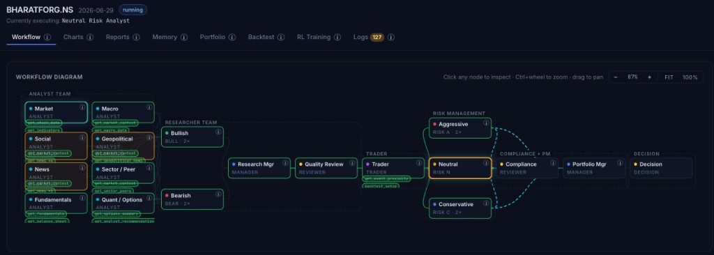
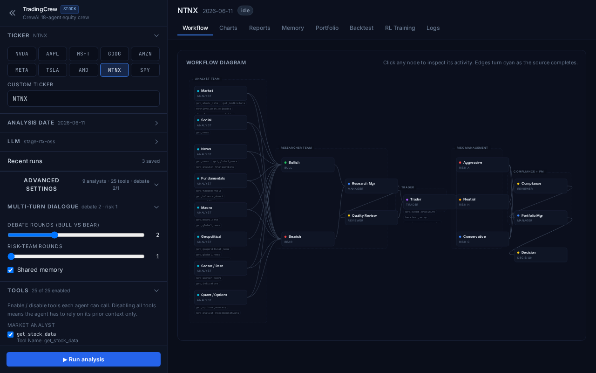
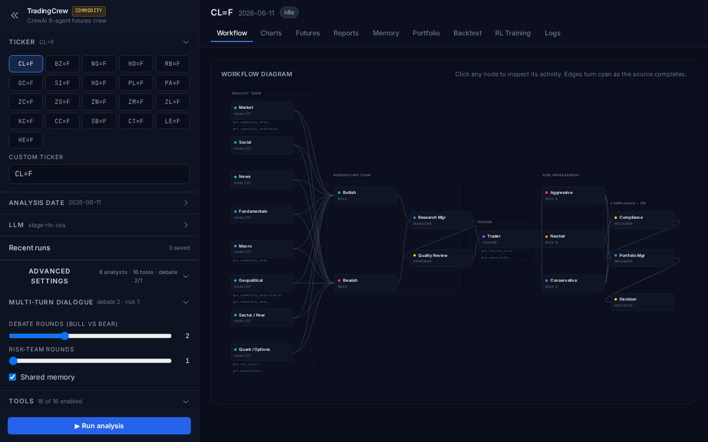
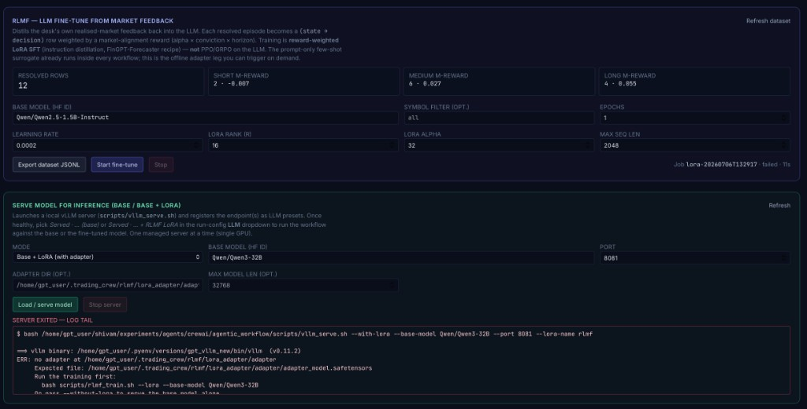
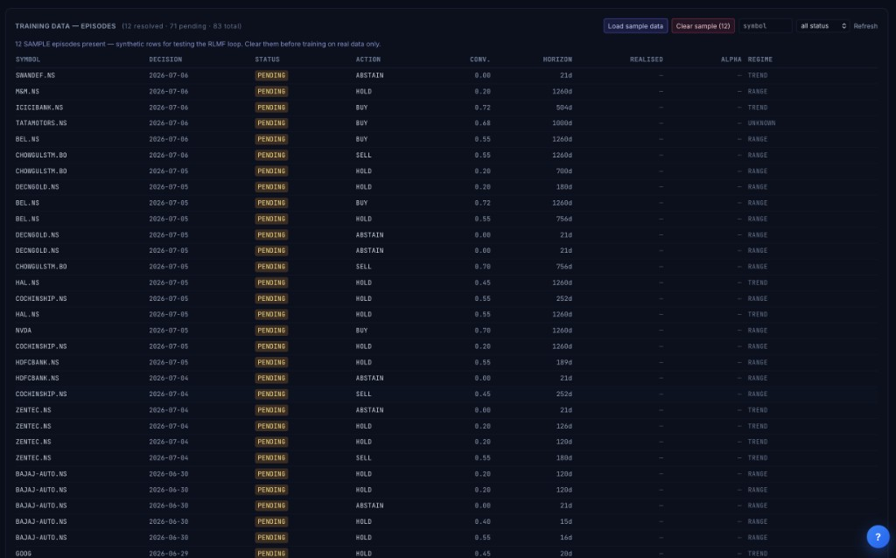

# TradingCrew — Full Documentation

> Complete reference for TradingCrew. For the high-level overview, see the [project README](../README.md).

> Multi-agent **stock + commodity** research workflow built on [CrewAI](https://docs.crewai.com), with a deterministic post-LLM pipeline (sizing, risk gates, execution simulator, episodic memory, walk-forward backtest, and optional PPO training).



A lean team of specialist LLM agents debates a trade idea; the verdict is then fed through 7 deterministic modules (M1–M7) so the *narrative* comes from an LLM but the *sizing, risk, and execution* are pure code you can read.

> **Lean workflow (2024 refactor).** The analyst team was consolidated from **8 narrow desks to 4 wider ones** (each a merged multi-lens desk), the Quality Reviewer + Compliance Officer became **optional advisory reviewers** (default off, run async), memory defaults **off**, and the reflective critic defaults to **single-pass**. Together these cut the per-run LLM-call count by well over half while keeping the multi-round bull/bear debate that drives reasoning quality. See [Workflow & LLM-call budget](#workflow--llm-call-budget).

---

## Why this exists

LLM-only trading agents are great at producing a confident-sounding rationale and terrible at producing a trade you'd actually let touch a book. TradingCrew puts an auditable, LangChain-free deterministic layer **after** the LLM debate so every decision lands as a typed `ActionProposal` that goes through:

| Stage | What it does |
| --- | --- |
| **M1** Bridge | Maps `PortfolioDecision` (LLM) → typed `ActionProposal` |
| **M2** Simulator | Next-bar fills + fees + half-spread + √-impact + partial fills |
| **M3** Episodic memory | Outcome-embargoed retrieval of past trades (no future leakage) |
| **M4** Reflective critic | 5-stage critique + 3-temperature consistency vote → may force ABSTAIN |
| **M5** Sizer + risk gates | Fractional Kelly × vol-target × CVaR clamp, then 6 hard gates |
| **M6** Walk-forward backtest | Embargoed train/test folds, **Deflated Sharpe** ranking |
| **M7** Allocator | HRP / Mean-Variance / Equal-Risk across all tickers |

See [Detailed design](#detailed-design) below for the full design, every endpoint, and the L2/L3/L4 training loops.

## Features at a glance

- **Two dashboards on one backend** — `/stock` (lean equities crew) and `/commodity` (futures crew with curve/COT/seasonality tools). Both run the same M1–M7 deterministic layer; only the cost-model preset differs.
- **Live workflow visualisation** — left-to-right SVG flow with idle / running (animated cyan dash) / done / degraded edge states; per-tool chip strip under each agent.
- **LLM + embedder picker in the UI** — switch between hosted vLLM, local vLLM, OpenAI, or Anthropic per run; the closed-source options grey out until the matching API key is set.
- **Multi-region tickers** — `AAPL`, `RELIANCE.NS`, `0700.HK`, `7203.T`, `HSBA.L`, `CL=F`, … resolved automatically with the right macro basket + news themes per country.
- **India-first data path** — `.NS` / `.BO` tickers optionally route through **screener.in** (Ind-AS fundamentals, promoter/FII/DII/public shareholding, SEBI/BSE announcements) and **upstox v3** (exchange-clean OHLCV, NSE F&O option chain) instead of yfinance, closing the corporate-action-adjustment and shareholding-visibility gaps. Toggled via `TRADINGCREW_SCREENER_ENABLED` and `UPSTOX_ANALYTICS_TOKEN`; disabled = the workflow falls back to the standard yfinance path.
- **Retail 5-tier decisions** — the Portfolio Manager emits `STRONG_BUY / BUY / HOLD / SELL / STRONG_SELL` (successor to the legacy `OVERWEIGHT / NEUTRAL / UNDERWEIGHT` triplet, silently coerced on load for backwards compatibility).
- **Three-tier horizon vocabulary** — every decision carries an explicit `horizon`: `SHORT` (≤ 3 months, catalyst plays), `MEDIUM` (a few months to a year — the desk's default), or `LONG` (1–10 years, compounder / value thesis). The `backtest_setup` panel now spans SHORT / MEDIUM / LONG windows out to `2520d ≈ 10y`, and `get_long_term_thesis` aggregates revenue / EPS CAGR + ROCE trend + shareholding drift from screener.in so the PM can anchor a genuine 5–10 year call on multi-year fundamentals rather than a chart pattern.
- **Four training loops** — L2 reflection on resolved outcomes, L3 walk-forward grid search ranked by Deflated Sharpe, L4 PPO on the M2 simulator (≈ 60–120s on CPU for a single ticker), and **L5 RLMF** — a FinGPT-inspired *Reinforcement Learning from Market Feedback* loop that ranks past decisions by realised alpha, tier, and conviction, then injects the top-K winners + bottom-K losers as a few-shot prefix on the PM prompt. `TRADINGCREW_RLMF_ENABLED=1` turns on the prompt-only surrogate; run `scripts/rlmf_train.sh` to export the FinGPT-Forecaster-compatible JSONL, print reward-distribution stats, or (with `--lora`) kick off an offline LoRA fine-tune of the RLMF adapter.
- **Direction-aware backtest** — `backtest_setup(ticker, horizon_days, target_pct, stop_pct, direction)` now accepts `direction="long"` or `direction="short"`. Before this fix, the tool silently simulated the LONG side for every trade, which meant SHORT plans on positive-drift names were shown a spuriously positive expectancy (the "+1.10% per trade" convergence pattern the desk was seeing across unrelated tickers). The trader task prompt now requires the LLM to pass `direction` explicitly on every call; SHORT-side backtests return returns signed by the short side so expectancy is directly comparable to the LONG case.
- **`long_term_view` is required on every decision** — even when the desk picks SHORT or MEDIUM, the PM's structured output carries a 1-2 sentence "multi-year thesis is intact / broken / N/A" line so the LONG-tier evidence is never silently dropped from the final report. LONG-tier decisions still carry the full 2-5 sentence narrative. The old field name `long_term_thesis` is accepted as an alias so persisted `RunRecord` JSONs keep loading.
- **Full audit trail** — every run is persisted to `~/.trading_crew/runs/{TICKER}/{ts}.json`. Open the **Recent runs** panel in the sidebar to re-load any prior run into the dashboard without re-running.

## Screenshots

**Stock dashboard** — sidebar (LLM/embedder picker, tools, multi-turn dialogue, recent runs) beside the left-to-right workflow diagram.



**Commodity dashboard** — same backend, futures tickers (`CL=F`, `NG=F`, …), an extra **Futures** tab (curve / COT / seasonality), and the futures cost-model preset.



**RLMF — fine-tune + serve from the UI** — export the reward-weighted dataset, kick off a LoRA fine-tune on any base model, and serve the base or the LoRA-tuned model locally (it registers as a selectable LLM preset). Adapter readiness and the vLLM log tail are surfaced inline for diagnostics.



**RLMF — training data (episodes)** — a Kaggle-style view of the episode store: summary cards over the loaded rows above a scrollable, sticky-header table. Resolved episodes become the reward-ranked training rows.



## Workflow & LLM-call budget

The equities crew defines **14 agent personas**; a **lean default run uses 11 agents** across 5 stages:

```
4 merged analyst desks (parallel)  →  Bull ⇄ Bear debate (N rounds)  →  Research Manager
    →  Trader  →  Aggressive ‖ Conservative → Neutral risk (per round)  →  Portfolio Manager → Decision
```

**The 4 merged analyst desks** (consolidated from 8 to cut redundant tool-loops and information dilution):

| Desk | Merged remit | Tools |
| --- | --- | --- |
| **Market** | price / technicals **+ options / positioning** (was Market + Quant) | `get_stock_data`, `get_indicators`, `get_options_summary`, `get_analyst_recommendations` |
| **News** | catalysts / corporate actions **+ sentiment / insider** (was News + Social) | `get_news`, `get_global_news`, `get_corporate_actions`, `get_insider_transactions` |
| **Fundamentals** | financials + long-term thesis **+ forward consensus + sector / peers** (was Fundamentals + Sector) | `get_fundamentals`, `get_balance_sheet`, `get_cashflow`, `get_income_statement`, `get_shareholding_pattern`, `get_long_term_thesis`, `get_forward_estimates`, `get_sector_peers` |
| **Macro** | macro regime **+ geopolitical / supply-chain** (was Macro + Geopolitical) | `get_macro_data`, `get_global_news`, `get_geopolitical_news`, `get_supply_chain_risk` |

**Toggles** (sidebar → *Dialogue* section, or `POST /api/sessions` body):

| Toggle | Default | Effect |
| --- | --- | --- |
| `memory` | **off** | CrewAI LLM-enriched episodic memory. Its per-task analyze passes were the single biggest source of LLM calls (~80/run), so it's opt-in. |
| `quality_review` | **off** | Advisory thesis audit. When on it runs **async** and feeds the PM (right-sizes the position; never forces a HOLD). |
| `compliance` | **off** | Sanctions / restricted-list / ESG gate. Runs **async** alongside Quality Review; advisory to the PM. |
| `critic_enabled` | **on** | Single-pass reflective self-audit of the final decision (fabricated-source + intent checks). |
| `critic_samples` | **1** | Raise to run the multi-temperature consistency vote (each extra sample = 1 extra LLM call). |
| `debate_rounds` | **2** | Bull ⇄ Bear rounds — kept multi-round because it materially improves reasoning quality. |
| `risk_rounds` | **1** | Aggressive/Conservative/Neutral risk rounds. |

**What runs in parallel.** CrewAI's sequential process drains pending async futures at the next *synchronous* task, so parallelism is exploited where the DAG allows it:

- **Analyst fan-out** — all 4 desks run concurrently (`async_execution`).
- **Risk debate** — Aggressive + Conservative argue independently in parallel each round; Neutral synthesises both.
- **Advisory reviewers** — when *both* Quality Review and Compliance are enabled they run as a concurrent async pair right before the PM, so their critical-path cost is `max(QR, compliance)` rather than the sum. They are **not** wired into the trader (they'd block it), which is why they advise the PM instead of gating the pipeline.

**Fabricated-citation fix.** LLMs sometimes invent an `example.com` URL in their own prose to satisfy the `[source: …]` provenance rule; a downstream reviewer then flags the (otherwise sound) claim as unsupported and downgrades the whole thesis. `sanitize_citations()` runs deterministically at the runner boundary and rewrites any `[source: <placeholder-url>]` tag to the honest `[analyst judgement]` label, leaving real URLs and real tool identifiers untouched.

## Quick start

```bash
git clone <your-fork-url> tradingcrew
cd tradingcrew/agents/crewai/agentic_workflow

python -m venv .venv
.venv/bin/pip install -r requirements.txt

cp .env.example .env       # fill in VLLM_LLM_* + TAVILY_API_KEY at minimum

./run_web.sh               # binds 0.0.0.0:8001
```

Open <http://localhost:8001> → pick a ticker → **Run analysis**.

For a single-shot CLI run (no UI):

```bash
.venv/bin/python main.py NTNX --debate-rounds 2 --risk-rounds 1
```

See [Detailed design → Quick start](#quick-start-1) below for the full configuration options, every env var, the LLM / embedder presets, the per-run call estimator, and the parallel memory save pool.

### Multi-run sessions (background execution)

Every "Run analysis" click creates a **background session** owned by the server, not the tab. Sessions survive page reloads, tab closes, and network blips — the frontend is a viewer, not the run itself. Practical implications:

* **Queue multiple tickers.** Kick off ZENTEC.NS, then RELIANCE.NS, then TCS.NS — they show up in the sidebar "Sessions" panel and run in parallel up to `TRADINGCREW_MAX_CONCURRENT_RUNS` (default `4`). Anything beyond the cap sits in `queued` and promotes to `running` when a slot frees up.
* **Refresh-safe.** Close and reopen the tab, or hit F5 mid-run — the browser reconnects to the same session by id (persisted in `localStorage`) and replays the full event buffer so the diagram + reports rebuild exactly where they were.
* **Batching = throughput.** With 3-4 concurrent kickoffs against a single vLLM server the decode-batch fills past `1`, roughly tripling aggregate tokens/sec on Qwen3-32B versus a purely sequential queue. `--enable-auto-tool-choice` in `scripts/vllm_serve.sh` is already batch-aware.
* **Cancel any session.** The row-level "Cancel" button targets *that* session's `run_id`; you don't need to attach to it first.

Wire-level API (for scripting / bots):

```bash
# Start
curl -X POST http://localhost:8001/api/sessions \
  -H 'content-type: application/json' \
  -d '{"ticker":"NVDA","debate_rounds":2,"risk_rounds":1}'
# → {"run_id":"20260704T183012-abcd1234","status":"queued", ...}

# List active + recent
curl http://localhost:8001/api/sessions

# Stream events (buffered replay + live tail)
websocat ws://localhost:8001/ws/session/<run_id>

# Cancel
curl -X POST http://localhost:8001/api/sessions/<run_id>/cancel

# Evict a terminal session from server memory
curl -X DELETE http://localhost:8001/api/sessions/<run_id>
```

Env-vars:

| Var | Default | Purpose |
| --- | --- | --- |
| `TRADINGCREW_MAX_CONCURRENT_RUNS` | `4` | How many CrewAI kickoffs may execute at once. Tune to your vLLM decode-batch sweet spot (usually 3-4 on 1×H100 for Qwen3-32B). |
| `TRADINGCREW_MAX_SESSIONS_RETAINED` | `20` | Cap on the in-memory session store; oldest terminal sessions are evicted first. |
| `LLM_MAX_TOKENS` | `0` (uncapped) | Optional per-request generation ceiling. Left **off** by default: capping mid-`<think>` on Qwen3 truncates responses and leaks raw reasoning into the content. Set to a positive int (e.g. `20000`) only as runaway insurance while diagnosing a stuck turn. The proper throughput lever is concurrency (above), not this cap. |

## RLMF training loop (L5)

L5 is the FinGPT-inspired **Reinforcement Learning from Market Feedback** loop. It reads resolved episodes from `~/.trading_crew/memory/episodes.jsonl`, ranks them by realised alpha × conviction × horizon-weight, and turns them into either a *prompt-only* few-shot prefix (fast, no training required) or an *offline LoRA fine-tune* on any HuggingFace base model.

### Prompt-only surrogate (no training)

```bash
export TRADINGCREW_RLMF_ENABLED=1
./run_web.sh                                # or main.py — the PM prompt now
                                            # gets a top-K / bottom-K prefix
```

### Offline LoRA fine-tune (any base model)

```bash
# 1) Export the FinGPT-Forecaster-compatible JSONL + reward stats
bash scripts/rlmf_train.sh --dataset-only

# 2) Kick off a LoRA fine-tune against ANY HF model.
#    Defaults to Qwen/Qwen3-32B (top of the 2026 32B reasoning leaderboards)
#    but --base-model accepts any causal LM; multimodal Gemma-4 is also
#    supported (see rlmf_lora.py --help).
bash scripts/rlmf_train.sh --lora \
    --base-model Qwen/Qwen3-32B \
    --epochs 3

# other examples
bash scripts/rlmf_train.sh --lora --base-model google/gemma-4-31b-it --epochs 3
bash scripts/rlmf_train.sh --lora --base-model Qwen/Qwen2.5-7B-Instruct --epochs 10
bash scripts/rlmf_train.sh --lora --base-model deepseek-ai/DeepSeek-R1-Distill-Qwen-32B --epochs 3
```

The training script prints a loss curve per epoch and saves the adapter to `${LORA_OUTPUT_DIR:-~/.trading_crew/rlmf/lora_adapter}/adapter/`. LoRA target modules are auto-selected: plain causal-LMs get `q/k/v/o_proj` suffix matching; multimodal architectures (like Gemma-4's `Gemma4ForConditionalGeneration`) are auto-detected and scoped to the language tower only so the vision / audio encoders stay frozen. Gradient checkpointing is enabled by default so 30B-class models fit on a single 95 GB H100 in bf16 — no 4/8-bit quantization needed for the models above.

Fits observed in practice:

| model | trainable | peak VRAM | 3-epoch wall clock (1×H100) | HF hub id |
|---|---:|---:|---:|---|
| Qwen3-32B (Thinking) | 40 M (0.12 %) | 70 GB | 162 s | `Qwen/Qwen3-32B` |
| Gemma-4-31B-IT | 45 M (0.14 %) | 71 GB | 215 s | `google/gemma-4-31b-it` |
| Qwen2.5-7B-Instruct | 40 M (0.51 %) |  38 GB |  95 s | `Qwen/Qwen2.5-7B-Instruct` |

## Serve the trained adapter with vLLM

`scripts/vllm_serve.sh` serves the same base you fine-tuned against, optionally with the RLMF LoRA adapter, so downstream clients can flip between them by just picking the `model` field:

```bash
# 3a) Serve base model only (baseline reference)
bash scripts/vllm_serve.sh --without-lora

# 3b) Serve base + RLMF LoRA adapter (registered as model name "rlmf")
bash scripts/vllm_serve.sh --with-lora
```

Once the server is up on `http://localhost:8081/v1`, either OpenAI-compatible model name is addressable:

```bash
# Base weights
curl -s http://localhost:8081/v1/chat/completions \
     -H 'Content-Type: application/json' \
     -d '{"model":"Qwen/Qwen3-32B","messages":[{"role":"user","content":"..."}]}'

# Base + LoRA
curl -s http://localhost:8081/v1/chat/completions \
     -H 'Content-Type: application/json' \
     -d '{"model":"rlmf","messages":[{"role":"user","content":"..."}]}'
```

Override anything via CLI flags or env vars: `--base-model <hf-id>`, `--adapter <dir>`, `--port <n>`, `--max-model-len <n>`, `--gpu-mem-util <f>`, `--dry-run`, or the corresponding env vars (`BASE_MODEL`, `ADAPTER_DIR`, `PORT`, `MAX_MODEL_LEN`, `GPU_MEM_UTIL`). Run `scripts/vllm_serve.sh --help` for the full list. The script auto-verifies the adapter's `base_model_name_or_path` matches `--base-model` and warns you before serving a mismatched pair (which would silently produce garbage).

Two flags matter for agent workflows and are enabled by default; override them per base model:

- **Tool calling** — `--tool-parser <s>` (default: `hermes`). CrewAI (and any framework that sets `tool_choice=auto`) requires vLLM's `--enable-auto-tool-choice --tool-call-parser <s>`, otherwise every tool-using request 400s. `hermes` covers Qwen3 / Qwen2.5; use `llama3_json` for Llama-family, `mistral` for Mistral, `granite` for Granite. Pass `--no-tool-choice` to disable for a chat-only base model.
- **Reasoning parser** — `--reasoning-parser <s>` (default: `qwen3`). Thinking models (Qwen3-Thinking, DeepSeek-R1, GPT-OSS, MiniMax-M2, GLM-4.5, Granite-Reasoning) emit chain-of-thought inside `<think>...</think>` tokens. Without the parser those raw tokens land in `choices[0].message.content` and CrewAI renders the monologue as the final analyst report. With the parser, the span is stripped into a separate `reasoning_content` field and only the post-`</think>` answer becomes `content`. Match the parser to the base model: `qwen3`, `deepseek_r1`, `openai_gptoss`, `minimax_m2`, `glm45`, `granite`, etc. Pass `--no-reasoning-parser` for non-thinking chat models (e.g. Qwen2.5-Instruct, plain Llama-Chat).

**Thinking mode on the memory subsystem.** CrewAI's memory helpers (`analyze_for_save`, `analyze_for_consolidation`, `analyze_query`, `extract_memories_from_content`) fire 3-4 concurrent classifier calls per agent step. On Qwen3-Thinking each call burns 20-30 k tokens of `<think>` before emitting a two-line JSON, saturates the vLLM KV cache, and — verified live on a ZENTEC.NS + Qwen3-32B run — stalls the whole workflow until the OpenAI SDK's 10-min read timeout fires. To keep full reasoning quality for the analyst / debate / PM pipeline while cutting this waste, `trading_crew._common.get_memory_llm()` builds a **dedicated LLM instance** for the memory subsystem that bakes `additional_params={"extra_body": {"chat_template_kwargs": {"enable_thinking": false}}}` when the base model is Qwen3. The main-agent LLM is unchanged. Result: `analyze_for_save` drops from ~12 s → ~2 s with identical classifier output. Non-thinking bases (Qwen2.5-Instruct, Llama, Gemma-4, OSS-120B) are passed through unchanged so `chat_template_kwargs` is never sent to a provider that would reject it.

If you'd rather turn thinking off *server-wide* for a benchmarking rig, pass `--disable-thinking` to `scripts/vllm_serve.sh`; it swaps in the pinned template at `scripts/chat_templates/qwen3_no_think.jinja` so every request gets `<think>\n\n</think>\n\n` pre-seeded.

To point the workflow at your local vLLM instead of the hosted default, either flip the `VLLM_LLM_*` env vars in `.env` to `http://localhost:8081/v1` + `Qwen/Qwen3-32B` (or `rlmf`), or pick **Local vLLM** from the sidebar preset dropdown.

### Driving the whole RLMF loop from the UI

Everything above (dataset export, LoRA fine-tune, serving with/without the adapter) is also wired into the **RL Training** tab so you never have to drop to a shell. The tab has three RLMF panels backed by `web/backend/rlmf_runner.py`:

- **Training data — episodes.** A Kaggle-style view of the raw episode store (`episodes.jsonl`): a row of **summary cards** up top (outcome-status counts over all rows; action / regime distributions and realised-return mean·min·max·avg-conviction over the loaded rows) sits above a **scrollable, sticky-header table** so the page doesn't grow unbounded with hundreds of episodes. It has a symbol/status filter; click a row to expand the `state_summary` the desk saw at decision time. This is the source data RLMF ranks — resolved rows become training rows; pending rows are waiting on their outcome window (resolve them from **Memory → Resolve outcomes & reflect**). If you don't have any resolved episodes yet, hit **Load sample data** to seed a spread of synthetic *resolved* episodes (tagged `SAMPLE-…`, spanning tiers / sides / win-loss) so you can exercise the whole export → fine-tune → serve loop immediately; **Clear sample** removes only those rows and leaves real episodes untouched. Endpoints: `GET /api/training/rlmf/episodes`, `GET /api/training/rlmf/dataset`, `POST /api/training/rlmf/sample/{seed,clear}`.
- **RLMF — LLM fine-tune from market feedback.** Pick **any base model** from the dropdown (free-text HF id accepted), set epochs / LR / LoRA rank+alpha / max-seq-len, and click **Start fine-tune**. It exports the dataset, then runs the reward-weighted LoRA SFT (`trading_crew/agentic/rlmf_lora.py`) on a background worker with a live loss log and a cooperative **Stop**. Endpoints: `POST /api/training/rlmf/export`, `POST /api/training/rlmf/lora/{start,stop}`, `GET /api/training/rlmf/lora/status`.
- **Serve model for inference (base / base + LoRA).** Lives in the **left sidebar → LLM → "Serve a local model"** panel (right next to the model picker), so loading a model — base or RLMF-LoRA-tuned — is configured in the same place you select it. It launches `scripts/vllm_serve.sh` as a managed child process and **registers the served endpoint(s) as LLM presets** — `Served · <model> (base)` and `Served · <model> + RLMF LoRA` show up at the top of the **Active model** dropdown, so you flip the workflow between the base and the fine-tuned model per run without editing `.env`. The panel shows adapter readiness up-front (the #1 reason a LoRA serve fails is that no adapter has been trained yet) and, if the server exits, the log tail. It defaults to **port 8091** (not 8081) so it doesn't collide with a primary vLLM already serving your run-config model on 8081. Because this spins up a *second* vLLM on the same GPU, it needs free VRAM: if a primary 32B tenant is already holding ~86 GiB, either serve a **small** model with a lower `gpu mem util` / `max seqs` (both exposed in the panel — `max seqs` avoids vLLM's sampler-warmup OOM), or stop the primary first. One managed server at a time (single GPU); a health poll flips the badge to `ready` once `/v1/models` responds. The RL-Training tab shows a read-only mirror of the serving status. Endpoints: `POST /api/training/rlmf/serve/{start,stop}`, `GET /api/training/rlmf/serve/status`. Everything here is available on both the `/stock` and `/commodity` dashboards.

> **Not GRPO/PPO on the LLM.** RLMF is *instruction distillation*: resolved decisions are turned into `(state → decision)` SFT rows weighted by `softplus(reward)` (reward = `alpha × conviction_weight × horizon_weight`). We deliberately avoid a PPO/GRPO policy-gradient trainer on the LLM — it's fragile and largely superseded by reward-weighted SFT / DPO for this dataset shape. (The separate **L4** loop *does* use PPO, but on a small actor-critic policy network over the M2 simulator, not on the language model.)

## Project layout (top level)

```
agentic_workflow/
├── main.py               # CLI entry point: python main.py NTNX
├── run_web.sh            # launches the FastAPI UI on :8001
├── trading_crew/         # lean equities crew + M1–M7 deterministic core
│   ├── crew.py           # @CrewBase, agents/tasks via @agent / @task
│   ├── tools.py          # @tool functions (yfinance + Tavily/SerpAPI) + sanitize_citations
│   ├── critic.py         # M4 reflective critic
│   └── agentic/          # asset-class-agnostic deterministic Layer-A
│       ├── portfolio/    # state, allocator (HRP / MV / EQR)
│       ├── execution/    # cost models, next-bar fill simulator
│       ├── memory/       # episodic / semantic / regime
│       ├── risk/         # VaR/CVaR, sizing, gates
│       ├── backtest/     # walk-forward engine, Deflated Sharpe
│       └── rl/           # L4 PPO trainer (env, networks, storage)
├── commodity_crew/       # futures crew (curve, COT, seasonality)
├── web/                  # FastAPI backend + Alpine.js frontend
├── scripts/              # sector_bias_basket, decision_impact_demo, audit_run, ...
├── tests/                # 730+ tests covering everything above
├── docs/                 # detailed design + screenshots
└── requirements.txt
```

## Tests

```bash
.venv/bin/pip install pytest pytest-asyncio
.venv/bin/python -m pytest tests/
```

730+ tests across every M1–M7 module, both crews, the FastAPI endpoints, the WebSocket runner, the L2/L3/L4 training loops, the degraded-output detection, the citation sanitizer, the lean-workflow call budget, and the ticker resolver.

## Inspiration & references

- **TauricResearch/TradingAgents** — the high-level multi-agent debate topology (analyst team → bull/bear → trader → 3-way risk → PM) is inspired by this Apache-2.0 project. <https://github.com/TauricResearch/TradingAgents>
- **Xiao et al., "TradingAgents: Multi-Agents LLM Financial Trading Framework"** — arXiv:[2412.20138](https://arxiv.org/abs/2412.20138) (2025).
- **Deterministic Layer-A design** — the M1–M7 contract (bridge, simulator, memory, critic, sizer + gates, walk-forward, allocator) draws on arXiv:[2605.19337](https://arxiv.org/pdf/2605.19337).

TradingCrew is an independent implementation: it is built on **CrewAI** (not LangGraph), adds a futures dashboard with cost-model presets, ships its own FastAPI/WebSocket web UI, and contributes the deterministic M1–M7 post-LLM pipeline + L2/L3/L4 training loops. No source code is copied from the upstream project. See [`NOTICE`](../NOTICE) for the full attribution.

## Disclaimer

This project is for **research and educational purposes only**. The deterministic risk layer is intentionally conservative, but LLM outputs are non-deterministic, market data is delayed, and back-tested performance is not a guarantee of future returns. **Nothing in this repository is investment advice.**

## License

Apache License 2.0 — see [`LICENSE`](../LICENSE) and [`NOTICE`](../NOTICE).

---

# Detailed design

> The following is the in-depth companion to the overview above: every module, endpoint, the M1–M7 deterministic pipeline, the L2/L3/L4/L5 training loops, the commodity dashboard, and the finance vocabulary.

Multi-agent **stock + commodity** research workflow built with [CrewAI](https://docs.crewai.com).

Two dashboards share the same homepage and the same deterministic backend:

- **`/stock`** — lean equities crew (4 merged analyst desks; consolidated from the original 8-desk `agentic_workflow.ipynb` lift). Portfolio Manager emits a typed `PortfolioDecision`.
- **`/commodity`** — futures crew with futures-aware tools (curve, COT, seasonality, geopolitics). Same debate topology as the equity crew — analysts → bull/bear debate → research manager → futures trader → 3-way risk debate → Portfolio Manager (with optional Quality Review + Compliance advisory reviewers). The Portfolio Manager emits a typed `FuturesDecision` that is bridged to a `PortfolioDecision` so it can flow through the same M1–M7 pipeline.

The Portfolio Manager (or its commodity equivalent) emits a typed decision JSON gated by a confidence guardrail. After the LLM debate completes, the decision is handed off to a **deterministic post-LLM pipeline (M1–M7)** that compiles a typed `ActionProposal`, runs risk gates + a fill simulator, books the position, and records an episode for time-aware retrieval on the next run.

> **Asset-class agnostic core.** The deterministic Layer-A pipeline (`trading_crew/agentic/*`) is identical for both dashboards. Only the LLM debate layer and the cost-model preset (`futures_standard` vs `standard`) differ.

```
[M4] Cascaded Controller (regime detector)
   ├── CRISIS  → short-circuit, skip the agent debate, route to ABSTAIN
   └── else    → continue
   ↓
4 merged analyst desks (parallel via async_execution)
  [M3] Market Analyst + Trader can call retrieve_past_episodes
  -> DEBATE_ROUNDS x (Bull -> Bear)
    -> Research Manager synthesis
        -> Trader (uses get_event_proximity + retrieve_past_episodes)
          -> RISK_ROUNDS x (Aggressive || Conservative -> Neutral)
              -> Portfolio Manager (output_pydantic = PortfolioDecision)
                ↓
   (optional, async, advisory to the PM: Quality Review audit +
    Compliance Officer CLEAR / FLAGGED / BLOCKED — default OFF)
                ↓
[M4] Reflective Critic (single-pass by default; raise critic_samples for the multi-temp consistency vote → may revise or ABSTAIN)
   ↓
[M1] Bridge: PortfolioDecision -> ActionProposal (deterministic, no LLM)
   ↓
[M5] Sizer (Fractional Kelly + vol-target + CVaR clamp + risk-debate multiplier)
   ↓
[M5] Risk Gates (concentration, leverage, drawdown stop, kill switch, ...)
   ↓
[M2] Execution Simulator (next-bar fill, partial fills, fees + half-spread + impact)
   ↓
[M1] PortfolioState update (atomic JSON store, audit trail)
   ↓
[M3] Episode written (state, action, outcome_ts, regime tag, embargo)
   ↓
[Phase E] Full run record persisted to ~/.trading_crew/runs/{TICKER}/{ts}.json
```

## Project layout

```
agentic_workflow/
├── pyproject.toml             # setuptools, picks up requirements.txt
├── requirements.txt           # crewai, yfinance, tavily, fastapi, …
├── .env.example               # LOCAL_LLM_*, TAVILY_API_KEY, OPENAI_API_KEY
├── main.py                    # CLI: `python main.py NTNX --debate-rounds 2`
├── run_web.sh                 # launches the FastAPI UI on :8001
├── trading_crew/              # ← equities crew
│   ├── __init__.py            # exposes TradingCrew, PortfolioDecision
│   ├── crew.py                # @CrewBase class; agents/tasks via @agent / @task
│   ├── tools.py               # 18 @tool functions (yfinance + Tavily)
│   ├── schemas.py             # PortfolioDecision Pydantic schema
│   ├── guardrails.py          # confidence_guardrail (4 rejection branches)
│   ├── _common.py             # get_llm + get_embedder_config factories
│   ├── critic.py              # M4 reflective critic
│   ├── agentic/               # ← asset-class agnostic deterministic core (M1–M7)
│   │   ├── reflection.py      #   L2 training — outcome resolution + LLM reflection
│   │   ├── grid_search.py     #   L3 training — walk-forward hyper-param sweep
│   │   ├── rl/                #   L4 training — PPO on the M2 simulator
│   │   │   ├── state.py       #     OHLCV → fixed-size feature vector
│   │   │   ├── env.py         #     Gym-style env wrapping the M2 simulator
│   │   │   ├── networks.py    #     Actor-critic MLP (PyTorch)
│   │   │   ├── ppo.py         #     PPO trainer (clipped surrogate + GAE + entropy)
│   │   │   ├── storage.py     #     Run records + checkpoints + promotion
│   │   │   └── inference.py   #     Load + score a promoted policy
│   │   ├── portfolio/         #   state, allocator (HRP / MV / EQR)
│   │   ├── execution/         #   cost (equity + futures presets), simulator, pipeline
│   │   ├── memory/            #   episodic / semantic / regime
│   │   ├── risk/              #   VaR/CVaR, sizing, gates
│   │   └── backtest/          #   walk-forward engine, metrics, manifest
│   └── config/
│       ├── agents.yaml        # 18 personas
│       └── tasks.yaml         # all task descriptions and expected_outputs
├── commodity_crew/            # ← 17-agent futures crew (full debate pipeline)
│   ├── __init__.py            # exposes CommodityCrew, FuturesDecision
│   ├── crew.py                # @CrewBase 17-agent debate + risk + PM workflow
│   ├── tools.py               # futures-aware tools (curve, COT, seasonality, …)
│   ├── schemas.py             # FuturesDecision Pydantic schema (contract_month, curve_view, roll_yield, …)
│   ├── bridge.py              # FuturesDecision → PortfolioDecision adapter
│   └── config/
│       ├── agents.yaml        # 8 commodity personas
│       └── tasks.yaml         # 8 tasks culminating in a FuturesDecision
└── web/
    ├── backend/
    │   ├── app.py             # FastAPI: /, /stock, /commodity, /api/options, /api/chart,
    │   │                      #          /api/memory/resolve, /api/grid_search,
    │   │                      #          /api/training/rl/{start,status,stop,runs,promote,recommend},
    │   │                      #          /api/commodity/{curve,cot,seasonality}, /ws/analyze
    │   ├── runner.py          # CrewAI step/task callbacks + asset-class routing
    │   ├── rl_runner.py       # L4 PPO background training worker + status tracker
    │   ├── charts.py          # OHLCV + indicator series (yfinance + stockstats)
    │   └── events.py          # event taxonomy + role→kind map for the diagram
    └── frontend/
        ├── homepage.html      # landing page — cards for Stock vs Commodity
        ├── index.html         # shared dashboard shell (asset-class aware)
        ├── diagram.js         # SVG workflow with positioned nodes + highlighted edges
        ├── charts.js          # Chart.js — price/RSI/MACD + futures curve/COT/seasonality
        ├── app.js             # Alpine controller (asset_class routing, WS, training, …)
        └── style.css          # dark theme + flow / tool-chip / sidebar widgets
```

## Quick start

### 1. Install

The project reuses the workspace `.venv` at `../.venv`. If you don't have one yet:

```bash
cd agentic_workflow
python -m venv .venv
.venv/bin/pip install -r requirements.txt
```

### 2. Configure

Copy `.env.example` to `.env` and fill in:

```ini
# Preferred — any OpenAI-compatible hosted vLLM-style endpoint. Pick a
# long-context model (~131K) if you plan to use the full 4-desk analyst
# debate flow — the bull / bear / research-mgr / PM prompts include every
# analyst report and can easily reach 30-50K tokens before the LLM
# responds.
VLLM_LLM_BASE_URL=https://your-vllm-host.example.com/v1
VLLM_LLM_MODEL=your-long-context-oss-model
VLLM_LLM_API_KEY=...

# Fallback — local vLLM (used only when the VLLM_LLM_* vars above are unset).
LOCAL_LLM_BASE_URL=http://localhost:8081/v1
LOCAL_LLM_MODEL=your-local-model
OPENAI_API_KEY=dummy

LLM_PROVIDER_PREFIX=hosted_vllm
TAVILY_API_KEY=...
```

`get_llm()` (in `trading_crew/_common.py`) prefers `VLLM_LLM_*` over `LOCAL_LLM_*`. All agents are constructed with `respect_context_window=True`, so if a prompt would still overflow the window CrewAI auto-summarises prior messages instead of hanging the request. Tavily is used by all news / supply-chain / geopolitical tools.

#### LLM picker in the UI

The sidebar exposes an **LLM** dropdown listing every preset in
`trading_crew/llm_presets.py::BUILTIN_PRESETS`. The user can pick a
different model per run without restarting the server:

* Open-source: `hosted-vllm-oss` (env-driven via `VLLM_LLM_*`),
  `local-vllm` (env-driven via `LOCAL_LLM_*`).
* Closed-source: OpenAI `gpt-4o-mini` / `gpt-4o`, Anthropic
  `claude-3-5-sonnet`. Closed-source options are greyed out until
  `OPENAI_PROD_API_KEY` / `ANTHROPIC_API_KEY` are set in `.env`.

Resolution order in `get_llm()`: env defaults → `LLM_PER_AGENT` JSON →
**active UI preset (thread-local)** → direct kwargs. Per-agent and UI
preset overrides compose, so you can pin the Reflective Critic to a
closed-source model via `LLM_PER_AGENT` while keeping the rest of the
crew on the UI's selected open-source preset.

#### Memory embedder (with truncation guard)

CrewAI's native short-term / long-term / entity memory is wired up by
`trading_crew/_common.py::get_embedder_config()`, which points at any
OpenAI-compatible embedding server:

```ini
VLLM_EMBEDDING_BASE_URL=https://your-embedding-host.example.com
VLLM_EMBEDDING_MODEL=embeddinggemma-300m   # or any OpenAI-compatible model
VLLM_EMBEDDING_API_KEY=...
TRADINGCREW_EMBEDDER_MAX_CHARS=6000        # default; ~1500 tokens
```

The UI also exposes an **embedding model** dropdown right under the LLM
picker (only relevant when memory is on).  Presets live in
`trading_crew/embedding_presets.py::BUILTIN_PRESETS`:

* `vllm-embedding` — env-driven, points at whatever `VLLM_EMBEDDING_*`
  resolves to (typical: `embeddinggemma-300m`, 768-d, 2048-token cap).
* `openai-text-embedding-3-small` — 1536-d, 8191-token cap. Closed-source,
  needs `OPENAI_PROD_API_KEY`.
* `openai-text-embedding-3-large` — 3072-d, 8191-token cap. Same key.

Switching presets is safe: the crew partitions the on-disk LanceDB store
by preset id (`/crew/<crew>/emb/<preset>`) so a 768-d store and a 1536-d
store coexist side-by-side instead of crashing the next `search_memory`
with *"query dim doesn't match the column vector dim"*.

Small embedders like `embeddinggemma-300m` cap inputs at **2048
tokens**. The Portfolio Manager's output (action + rationale +
falsifiers + analyst summaries) can exceed that and surface as a
confusing `400 - maximum context length is 2048 tokens` *right after
PM finishes*. To prevent this, `get_embedder_config()` returns a
**custom** CrewAI provider (`trading_crew/embedder.py::TruncatingOpenAIEmbedder`)
that pre-truncates every document to `TRADINGCREW_EMBEDDER_MAX_CHARS`
characters before forwarding to chromadb's OpenAI embedding function.
The default 6000 chars (~1500 tokens) keeps a comfortable margin under
the 2048-token cap; bump it only if you switch to a larger-window
embedder.

Two implementation details worth knowing:

1. **Multi-inheritance.** `TruncatingOpenAIEmbedder` inherits from
   both `crewai.rag.embeddings.providers.custom.embedding_callable.CustomEmbeddingFunction`
   *and* `chromadb.api.types.EmbeddingFunction`. CrewAI's pydantic
   `EmbedderConfig` validates the custom callable against the chromadb
   protocol via `issubclass()`, which (for `runtime_checkable`
   Protocols) still requires *explicit* inheritance.
2. **Config from env vars + active preset, not kwargs.** CrewAI's
   `CustomProviderConfig` TypedDict only declares `embedding_callable`
   — pydantic strips every other key (`api_key`, `model_name`,
   `api_base`, `max_chars`) during validation. So
   `get_embedder_config()` returns `{"provider": "custom", "config":
   {"embedding_callable": …}}` *only*, and the embedder reads its
   credentials and budget from the **active UI embedding preset**
   (thread-local) or the `VLLM_EMBEDDING_*` /
   `TRADINGCREW_EMBEDDER_MAX_CHARS` env vars at construction time.

The crew constructs `Memory(llm=get_llm(), embedder=…, root_scope=…)`
explicitly (instead of `memory=True`) so CrewAI's analyze subsystem
runs against **our** local LLM rather than defaulting to
`gpt-4o-mini` against the placeholder `OPENAI_API_KEY=dummy` the vLLM
client needs.  Memory is gated by the **LLM-enriched memory** toggle
in the sidebar — when off, no `Memory` object is constructed at all
and every task starts fresh.

#### Parallel save pool

CrewAI's default `Memory._save_pool` is a
`ThreadPoolExecutor(max_workers=1)`, which serializes every
`remember()` call.  On a single ticker run there are roughly **100
memory-analyze calls** (≈ 28 tasks × 3.5 analyze calls + ~12
`search_memory` recall analyses); at ~10 s each against a typical
hosted vLLM endpoint that's *17 minutes* of LLM time if they all queue
sequentially.  This is exactly why memory-on used to balloon a 5-min
run to ~30 min.

After constructing `Memory`, we shut the default pool down and swap
it for `ThreadPoolExecutor(max_workers=8, …)` (configurable via the
`TRADINGCREW_MEMORY_SAVE_WORKERS` env var).  Combined with the
existing 10-worker pool inside `EncodingFlow` (for batch-internal
items), concurrent saves fan out and we can saturate the local-LLM
60-req/min throughput budget — bringing memory-on runs back to ~5
min while keeping the full LLM-enriched scope/category/entity
metadata that the analyze pass produces.

#### Per-run call estimate (shown in the UI)

The sidebar displays an estimate next to the memory toggle (e.g.
*"~108 LLM analysis calls ≈ 1.8 min"*) so users see the cost before
launching a run.  The formula:

```
tasks ≈ 4 analysts                          # merged analyst grid (1 task each)
      + (2 × debate_rounds)                  # bull + bear per round
      + 2                                    # research-mgr + trader
      + (quality_review ? 1 : 0)             # optional advisory reviewer
      + (3 × risk_rounds)                    # 3 risk personas per round
      + (compliance ? 1 : 0)                 # optional advisory reviewer
      + 1                                    # portfolio manager

calls ≈ tasks × 3.5 + 12                     # ~3.5 analyze calls/task + ~12 recall calls (memory ON only)
minutes ≈ calls / 60                         # local LLM rate limit = 60 req/min
```

With memory **off** (the default) there are no analyze/recall calls at
all — the estimate is just the agent tasks themselves.  These
*analysis* calls (memory on) run in parallel with agent work, so the
*effective* added wall-clock is closer to half the figure above on
typical runs (around 1 min for default sliders).

### 3. Run from the CLI

```bash
python main.py NTNX --debate-rounds 2 --risk-rounds 1
```

End of run prints the typed `PortfolioDecision` JSON.

#### Sector-bias basket runner

`scripts/sector_bias_basket.py` runs the full crew across a diverse US + India + multi-sector basket and writes a markdown report flagging any country / sector concentration in the decision mix.

```bash
../.venv/bin/python scripts/sector_bias_basket.py
# or pick your own subset:
../.venv/bin/python scripts/sector_bias_basket.py --tickers NVDA,AAPL,RELIANCE,MAZDOCK
```

Reports land in `reports/sector_bias_<timestamp>.{json,md}`. The companion static check `tests/test_sector_bias.py` runs in CI and catches hardcoded ticker / sector priors in prompt files.

#### Decision-impact worked example (backtest + walk-forward)

`scripts/decision_impact_demo.py` is the deterministic worked example for
"how much did the multi-horizon `backtest_setup` panel + the M6
walk-forward actually move the PM's decision?". It replays the
deterministic levers without calling an LLM, so it runs in seconds and
produces a markdown + JSON report:

```bash
../.venv/bin/python scripts/decision_impact_demo.py RELIANCE.NS --horizon 20 --target-pct 8 --stop-pct 3
../.venv/bin/python scripts/decision_impact_demo.py NTNX --horizon 20 --target-pct 6 --stop-pct 3
```

Reports land in `reports/decision_impact_<TICKER>_<ts>.{md,json}`.

For a real run on 2026-06-26, the two cases below illustrate the
complementary roles of the two halves:

| Ticker | OLD rules (pre-2F) | NEW rules (current) | Δ size | Δ confidence | Walk-forward says |
|---|---|---|---:|---:|---|
| RELIANCE.NS | NEUTRAL, 0% size, conf 0.55 | **OVERWEIGHT**, 1.12% size, conf 0.81 | **+1.12%** | **+0.26** | _silent_ (no proposal history yet) |
| NTNX | OVERWEIGHT, 1.5% size, conf 0.60 | OVERWEIGHT, 1.5% size, conf **0.79** | 0 | **+0.19** | Sharpe **−7.94** out-of-sample — temper conviction |

The reports in `reports/decision_impact_<TICKER>_<ts>.{md,json}` capture
both cases with the per-horizon bar charts, side-by-side PM decisions,
and the walk-forward overlay.

### 4. Run the web UI

```bash
./run_web.sh                     # binds 0.0.0.0:8001
PORT=9001 ./run_web.sh           # custom port
HOST=127.0.0.1 ./run_web.sh
```

Open http://localhost:8001. The **homepage** shows two cards:

- **Stock Trading** → `/stock`  (NVDA, AAPL, MSFT, …; lean 4-desk equity crew)
- **Commodity Trading** → `/commodity`  (CL=F, GC=F, ZC=F, …; 17-agent futures crew)

Both dashboards share the same UI shell. The page detects the asset class from the URL and:

- swaps the ticker preset grid (equities vs continuous-futures contracts),
- swaps the agent / tool catalog rendered in the sidebar,
- shows an extra **Futures** tab on `/commodity` (curve, COT, seasonality charts),
- selects the `standard` vs `futures_standard` cost-model preset when running M2.

Common tabs:

| Tab        | What it shows |
| ---------- | ------------- |
| Workflow   | Strict left-to-right SVG diagram, one column per pipeline stage: 4 merged analyst desks → bull/bear (parallel) → research mgr → trader → risk team (3 stacked, parallel) → portfolio mgr → decision, with the optional Quality Review + Compliance reviewers advising the PM. Parallel agents stack vertically inside a single column; sequential hand-offs each get their own column. Edge animation mirrors the React-Flow / Argo / GitLab CI convention: **idle** = thin gray, **running** = cyan dashed line that *flows* toward its destination via `stroke-dashoffset` animation, **done** = solid green. Each agent with tools shows a chip strip below its node — chips light yellow on tool start and green on success. Click any node to inspect its activity. Toolbar in the top-right has `−` / `+` / `Fit` / `100%` buttons (plus **Ctrl + scroll** to zoom at the cursor and drag-to-pan in the surrounding viewport). |
| Charts     | 180-day price chart with toggleable EMA / SMA / Bollinger overlays, plus dedicated RSI and MACD panels. Data comes from `/api/chart` (yfinance + stockstats). |
| Futures    | *(commodity dashboard only)* Term-structure chart for the front 6 contracts, weekly CFTC Commitments-of-Traders chart, and 5-year monthly seasonality bars. |
| Reports    | Each completed task's full markdown output in execution order, plus the final decision card (action / sizing / drivers / risks / falsifiers / compliance). |
| Memory     | Embargo-aware retrieval of past episodes for this ticker. **L2 training** button **Resolve outcomes & reflect** triggers `/api/memory/resolve` to compute realised PnL / α / max-DD for any episode whose `outcome_ts` has elapsed and (optionally) generate an LLM reflection per episode. |
| Backtest   | Walk-forward replay of recorded proposals (no new LLM calls). Includes the **L3 Auto-tune sizing & risk gates** panel — kicks `/api/grid_search` which sweeps `kelly_fraction × vol_target × max_position_weight`, ranks by Deflated Sharpe to control for selection bias, and reports the best configuration. |
| Portfolio  | Book snapshot + HRP / MV / Equal-Risk allocator preview over the most recent proposal per ticker. |
| Logs       | Live event-by-event console of every `node_started` / `tool_call` / `tool_result` / `node_completed` etc. with timestamps and elapsed times. |

The sidebar exposes:

- **Ticker** preset grid + custom input
- **Analysis date** (drives the chart end-date)
- **LLM** read-only summary of the configured `LOCAL_LLM_*` env values
- **Advanced settings** (collapsed by default):
  - Multi-turn dialogue: debate rounds (1–4), risk rounds (1–3), shared-memory toggle.
  - **Tools** — per-agent enable/disable checkboxes. Disabling a tool hands the
    agent a shorter tool list at construction time.
- **▶ Run analysis** stays sticky at the bottom of the sidebar.

WebSocket protocol: client sends a single JSON config frame on `/ws/analyze`, then receives JSON events of types `run_started → node_started → tool_call → tool_result → node_completed → final_decision → run_completed`.

### Streaming-gap fix

CrewAI's `step_callback` only fires once per task with the local LLM (native function calling lumps all tool iterations into one `AgentFinish`). For tool-less sequential agents (Bull / Bear / Research Manager / Quality Reviewer / risk team / Compliance / PM) that means the UI used to sit completely silent for 30–60 s after the analyst phase while the next single LLM call ran — looking like the workflow was "stuck after analyst team".

Two fixes in `runner.py`:

1. The runner pre-computes `expected_role_order = [t.agent.role for t in crew.tasks]` and synthesizes `node_started` for the next-up agent as soon as the previous task completes — so the diagram lights the next node immediately.
2. Per-tool `tool_call` / `tool_result` events come from the CrewAI **event bus** (`ToolUsageStartedEvent` / `ToolUsageFinishedEvent`) rather than `step_callback`. This is required because native-tool LLMs bypass `step_callback` for individual tool iterations.

## Files you'll usually edit

| To change… | Edit |
| --- | --- |
| Any agent's persona | `trading_crew/config/agents.yaml` |
| Any task's prompt   | `trading_crew/config/tasks.yaml` |
| Tool wiring or new tools | `trading_crew/tools.py` + `crew.py` |
| Guardrail rules     | `trading_crew/guardrails.py` |
| Final-decision schema | `trading_crew/schemas.py` |
| ActionProposal bridge | `trading_crew/agentic/bridge.py` |
| Risk / sizing / gates | `trading_crew/agentic/risk/{var,sizing,gates}.py` |
| Cost model + simulator | `trading_crew/agentic/execution/{cost,simulator}.py` |
| Episodic memory       | `trading_crew/agentic/memory/{episodic,semantic,regime}.py` |
| Allocator (HRP / MV)  | `trading_crew/agentic/portfolio/allocator.py` |
| Backtest engine       | `trading_crew/agentic/backtest/{engine,walk_forward,metrics,manifest}.py` |
| UI lanes / styling  | `web/frontend/{index.html,app.js,style.css}` |

## What is "backtest"?  (and why two places say "backtest")

There are **two different backtests** in this codebase. They share a name only because the LLM literature uses the same word for both. Knowing which is which removes a lot of confusion.

### 1. `backtest_setup` tool — *single-trade base-rate lookup*

Lives in `trading_crew/tools.py`. Runs automatically inside the LLM Trader's task. Given a ticker + a candidate (target%, stop%, horizon-days, **direction**) trade idea, it scans the historical price tape and computes:

- N samples that ever started a position under those entry conditions,
- win rate (target hit first), stop-out rate, timeout rate,
- avg / median realised return,
- payoff ratio and per-trade expectancy across a SHORT / MEDIUM / LONG multi-horizon panel out to `2520d ≈ 10y`.

It's a **decision-time aide** for sizing one specific trade idea — "out of 1225 historical setups like this, 20% hit target". It runs on every Trader task and you'll see its output in the Reports tab inside the Trade Plan card.

**Direction-aware (regression fix, 2026):** the tool now takes an explicit `direction="long"` or `direction="short"`. Before this fix `_simulate_horizon` was LONG-only — for a SHORT trade the trader passed positive target/stop magnitudes and the tool computed "did the price go UP target% or DOWN stop%", which is the wrong distribution. On most surviving liquid names (which have positive long-run drift) that silently over-reported SHORT-trade expectancy and produced a suspicious "~+1 to +2% per trade" convergence across unrelated tickers. `direction="short"` inverts the WIN / LOSS conditions (WIN when price falls target%, LOSS when it rises stop%) and signs the returns so expectancy is directly comparable to the LONG case. The trader task prompt now requires the LLM to pass `direction` on every call.

### 2. Walk-forward backtest engine — *strategy-level replay*

Lives in `trading_crew/agentic/backtest/`. Replays **all `ActionProposal`s you have ever logged** for a ticker through the same M1+M2+M5 deterministic pipeline (risk gates + cost model + simulator) under embargoed train/test folds, then reports:

- equity curve,
- Sharpe / Sortino / Calmar / MaxDD / **Deflated Sharpe** (selection-bias corrected),
- per-fold metrics.

This is the **Backtest tab** in the UI and the `GET /api/backtest` endpoint.

> **Why it sometimes shows "need N more proposals":** the walk-forward engine needs ≥ `train + embargo + test` proposals to form even one fold. The UI defaults to `train=3 / embargo=1 / test=1` (5 proposals minimum). Run analyses on a ticker enough times to clear that threshold and the equity curve appears.

## Agentic training on historical data (L2 + L3 + L4 + L5)

Beyond the inference-time M3 episodic memory ("L1"), the system has four offline training loops you can drive from the UI or the API.

| Level | What it learns | What it updates |
| ----- | -------------- | --------------- |
| **L1** | (no learning — retrieval only) | Episodic memory query results at inference time |
| **L2** | Per-episode reflections from realised outcomes | Episode reflection field consumed by `retrieve_past_episodes` next run |
| **L3** | Best sizing & risk-gate hyperparameters via walk-forward grid search | M5 config that the runner sends into `run_pipeline` |
| **L4** | A *parametric policy network* end-to-end via PPO | Torch checkpoint surfaced to the LLM through the `rl_policy_recommendation` tool |
| **L5** | Prompt-level distillation of past wins/losses ranked by market-alignment reward — the FinGPT-inspired RLMF loop | Few-shot exemplar block prefixed onto the Portfolio Manager task next run (optionally: LoRA JSONL for offline fine-tuning) |


### L2 — outcome resolution + LLM reflection

Module: `trading_crew/agentic/reflection.py`. Endpoint: `POST /api/memory/resolve`.

For every `Episode` whose `outcome_ts` has elapsed but whose actual outcome was never written back:

1. Re-fetch OHLCV between `decision_ts` and `outcome_ts`.
2. Compute **realised return** (signed by side), **alpha vs SPY benchmark**, **max drawdown**.
3. If an LLM is configured (`skip_llm: false`), ask it for a structured reflection: *what worked, what didn't, what to do differently*.
4. Patch the episode in place — future runs of the `retrieve_past_episodes` tool now surface this reflection verbatim to the Market Analyst + Trader.

UI: **Memory tab → Resolve outcomes & reflect** button.

```bash
curl -X POST localhost:8001/api/memory/resolve \
  -H 'content-type: application/json' \
  -d '{"ticker": "NTNX", "skip_llm": false}'
```

Status codes per episode: `RESOLVED`, `SKIPPED_PENDING` (horizon not elapsed), `SKIPPED_NO_DATA`, `ABANDONED` (older than the configurable cutoff).

### L3 — walk-forward grid search on sizing & risk

Module: `trading_crew/agentic/grid_search.py`. Endpoint: `POST /api/grid_search`.

Sweeps a grid of `kelly_fraction × vol_target × max_position_weight` over your logged proposals using the M6 walk-forward engine. **Ranking is by Deflated Sharpe**, which corrects for selection bias when you test many configurations against the same history (Bailey & Lopez de Prado, 2014). The "best" configuration the UI surfaces is the one that survived this correction, not the highest raw Sharpe.

UI: **Backtest tab → Auto-tune sizing & risk gates** panel.

```bash
curl -X POST localhost:8001/api/grid_search \
  -H 'content-type: application/json' \
  -d '{"ticker": "NTNX", "size": 5, "rank_by": "deflated_sharpe"}'
```

### L4 — Full RL with the M2 simulator as the environment

Module: `trading_crew/agentic/rl/`. Endpoints: `/api/training/rl/*`. UI: **RL Training** tab.

This is the closed-loop training the rest of M1–M7 was setting up for. Agents *act*, the M2 simulator *pays out*, gradients flow back into the policy network.

```
                                gradients
       ┌─────────────────────────────────────────────────┐
       │                                                 ▼
+------+------+    state    +---------------+   action   +----------------+
|             | ──────────▶ | Actor-Critic  | ─────────▶ |  M2 Simulator  |
|   Feature   |             |  (PyTorch     |            |  (next-bar     |
|  extractor  |             |   MLP, ~8K    |            |   fill + fees  |
|             |             |   params)     |            |   + impact)    |
+-------------+             +---------------+            +-------+--------+
       ▲                          ▲                              │
       │      observation         │ value                        │ reward
       │      ←────────────────── │ ←────────────────────────────┘
       │
       │
   PortfolioState (mark-to-market every bar — drawdown gate, NAV)
```

What it is:

- **Algorithm**: Proximal Policy Optimization (PPO) — clipped surrogate, GAE-λ advantages, value-function clipping, entropy bonus, gradient clipping. Standard PPO tricks; no stable-baselines3 dependency, ~200 lines of in-tree code.
- **Network**: 2-hidden-layer MLP (64 units, tanh, orthogonal init). Tiny on purpose — daily OHLCV gives you ~1000 bars per ticker and bigger nets just overfit.
- **State (21 features)**: past-10 log-returns, realised vol (z-scored), 5/20-day momentum, RSI(14), MACD, Bollinger %b, current position weight + unrealised PnL + bars-in-trade, day-of-week sin/cos.
- **Action space**: 7 discrete target-weight buckets — `-20%, -10%, -5%, 0%, +5%, +10%, +20%`. The same grammar the LLM uses (`SHORT / NEUTRAL / LONG` + size tier).
- **Reward**: per-bar Δ NAV / starting NAV after the M2 simulator deducts fees + slippage + impact + carry. Optional shaping terms: turnover penalty, drawdown penalty, hard drawdown-kill termination.
- **Asset class**: agnostic. The runner selects the `futures_*` cost preset automatically when `asset_class == "commodity"`.

How to use it:

1. Open the **RL Training** tab on either `/stock` or `/commodity`.
2. Pick a ticker, tweak `total_steps`, `learning_rate`, `entropy_coef`, `train_window_days`, `eval_window_days`, `drawdown_kill_pct`, `cost_model_name`.
3. Click **Start training**. The live chart streams `mean_episode_pnl_pct` / `entropy` / `sharpe_per_step` from each rollout; the bottom strip shows the final action distribution + per-rollout PPO diagnostics (policy loss, value loss, approx KL, clip fraction).
4. When the run finishes, the **Run history** table at the bottom shows eval PnL%, eval vs buy-and-hold, eval max drawdown, and a **Promote** button.
5. Promote the run — that writes a single pointer in `~/.trading_crew/rl_runs/promoted/<TICKER>.json`. **Until you promote, the policy stays invisible to the LLM crew** (no implicit "use the latest run" fallback — half-trained policies should not bleed into live decisions).
6. Click **Preview promoted-policy action** to see what the active policy would do *today* on the current OHLCV — direction + confidence + full action distribution.
7. Run a regular analysis. The Market Analyst + Trader now have an extra tool, `rl_policy_recommendation` (or `rl_policy_recommendation_commodity`), which returns the same recommendation as a markdown block. The LLM is free to follow it, discount it, or override it — it's an **advisory** prior, not a hard override.

CLI example end-to-end:

```bash
# 1. Kick off training (runs in a background worker, returns the record immediately).
curl -X POST localhost:8001/api/training/rl/start \
  -H 'content-type: application/json' \
  -d '{
    "ticker": "SPY",
    "asset_class": "stock",
    "train_window_days": 750,
    "eval_window_days": 120,
    "ppo_config": {"total_steps": 20000, "entropy_coef": 0.01}
  }'

# 2. Poll progress.
curl 'localhost:8001/api/training/rl/status?ticker=SPY' | jq

# 3. After it transitions to status="completed", list runs + promote the winner.
curl 'localhost:8001/api/training/rl/runs?ticker=SPY' | jq '.runs[0]'
curl -X POST localhost:8001/api/training/rl/promote \
  -H 'content-type: application/json' \
  -d '{"ticker": "SPY", "run_id": "20260611T170611-825"}'

# 4. Score the live state through the promoted policy.
curl -X POST localhost:8001/api/training/rl/recommend \
  -H 'content-type: application/json' \
  -d '{"ticker": "SPY"}' | jq '.recommendation'
```

Persistence layout (under `$TRADINGCREW_CACHE_DIR/rl_runs/`):

```
rl_runs/
  SPY/
    20260611T170611-825/
      record.json     # config + metrics + eval result
      policy.pt       # torch checkpoint (load with PPOTrainer.load_model)
      metrics.jsonl   # one TrainingMetrics per line (streams to the UI)
  promoted/
    SPY.json          # { ticker, run_id, asset_class, promoted_ts, summary }
```

Worth keeping in mind:

- A run with `total_steps=20_000` and the default 512-step rollouts trains in **~60-120 s on CPU** for a single ticker.  The default MLP is intentionally small (~8K params) — bigger nets overfit on a single ticker's history.
- The eval window is **strictly held out** from training.  The runner slices the most recent `eval_window_days` bars off the end, trains only on what's before that, and reports `eval_result` (PnL%, drawdown, action frequency, vs buy-and-hold) on the held-out segment.
- **No future leakage**: feature extraction uses only bars up to and including `t`, and the simulator always fills at `t+1` open.  This is the same guarantee M2 enforces for live runs.
- Stopping a run is **cooperative** (the trainer checks a `should_stop` flag between rollouts).  Hitting Stop in the UI calls `/api/training/rl/stop` which sets the flag and joins the worker.

### L5 — RLMF (Reinforcement Learning from Market Feedback)

Module: `trading_crew/agentic/rlmf.py`.  Env-gate: `TRADINGCREW_RLMF_ENABLED=1`.

Inspired by [FinGPT](https://github.com/AI4Finance-Foundation/FinGPT), the RLMF loop adapts the RLHF framework used to align ChatGPT: instead of ranking pairs of responses by *human preference*, we rank past decisions by *market feedback* — the realised return of the decision over its stated horizon.  Two paths ship in-tree:

#### 1. Prompt-only surrogate (default when enabled)

Runs on every workflow.  For every RESOLVED episode we compute:

```
reward = alpha_return × conviction_weight(conv) × horizon_weight(tier)
```

where `alpha_return` is realised return **less the SPY benchmark** (a +5% return during a +8% rally is a *negative* alpha and gets negative reward), `conviction_weight(0.5) ≈ 1.0` and scales linearly out to `1.4` for high-conviction outcomes, and `horizon_weight` up-weights LONG-tier wins (`1.25×`) and down-weights SHORT-tier scalps (`0.75×`) — this matches the desk's mid-to-long-term bias so the RLMF loop reinforces the *right* type of alpha.

At crew build time we then:

1. Rank the resolved case-book descending by reward.
2. Pick top-K wins ("PAST WINS TO EMULATE") + bottom-K losses ("PAST LOSSES TO AVOID"), configurable via `TRADINGCREW_RLMF_K_WINS` / `TRADINGCREW_RLMF_K_LOSSES`.
3. Format each into a compact markdown block (symbol, decision date, action, horizon tier, realised / alpha / reward, state summary, reflection).
4. Prefix the block onto the Portfolio Manager task's `description` before the regular prompt.

The PM now sees, in-prompt: *"here are the past prompts that turned into positive alpha — emulate their shape; here are the ones that turned into losses — avoid their shape"*.  Needs no GPU, no LoRA training, and takes effect the next run.

Diagnostic CLI:

```bash
# Show n_resolved + per-tier / per-action mean reward + top wins/losses
python -m trading_crew.agentic.rlmf --summary

# Print the exact prompt prefix the PM would see (useful before flipping
# TRADINGCREW_RLMF_ENABLED=1 on for live runs).
python -m trading_crew.agentic.rlmf --few-shot --k-wins 3 --k-losses 2

# Filter to one ticker or one horizon tier.
python -m trading_crew.agentic.rlmf --summary --symbol AAPL
python -m trading_crew.agentic.rlmf --few-shot --horizon LONG
```

#### 2. LoRA fine-tune (offline, optional)

For the "actual" RLMF path the FinGPT paper describes, use the wrapper script:

```bash
# Export the FinGPT-compatible JSONL + print the reward-distribution summary
scripts/rlmf_train.sh

# Print the prompt-only prefix the PM would see (dry-run, no export)
scripts/rlmf_train.sh --few-shot

# Restrict to a single symbol / tier
scripts/rlmf_train.sh --symbol AAPL --horizon LONG

# Kick off the FinGPT-Forecaster LoRA fine-tune (needs torch + peft + a GPU)
scripts/rlmf_train.sh --lora
```

The JSONL is shaped to be a drop-in replacement for the [`FinGPT/fingpt-forecaster-dow30-202305-202405`](https://huggingface.co/datasets/FinGPT/fingpt-forecaster-dow30-202305-202405) dataset on Hugging Face — every row carries the FinGPT-Forecaster `prompt` + `response` keys alongside our own analytics fields (`horizon`, `action`, `reward`, `alpha_return`).  Under the hood, `--lora` delegates to `trading_crew/agentic/rlmf_lora.py`, which runs an SFT + LoRA pass with sample weights derived from the RLMF reward (`softplus(reward)` clipped to `[0.05, 4.0]` — the same curve the FinGPT-Forecaster paper found most stable).  You can also drop the JSONL into the standard [FinGPT LoRA notebook](https://github.com/AI4Finance-Foundation/FinGPT/blob/master/FinGPT_%20Training%20with%20LoRA%20and%20Meta-Llama-3-8B.ipynb) if you prefer that recipe.

Notes:

- LoRA fine-tuning is out-of-process (24 GB GPU, ~60-90 minutes on an A100 — see the FinGPT project for the exact recipe).  `scripts/rlmf_train.sh --lora` runs the "5-minute smoke-test" version on a small base model (`Qwen/Qwen2.5-1.5B-Instruct` by default so the fine-tune actually fits on a single 24 GB card); heavier bases work too via `--base-model`.
- The prompt-only path is what runs in production every day.  Operators typically adopt the LoRA path only after `n_resolved` grows past ~200 decisions — below that the LoRA overfits and the few-shot prefix wins.  `scripts/rlmf_train.sh --lora` refuses to run with fewer than 20 rows to keep users from wasting GPU minutes on a degenerate dataset.
- The RLMF loop is **complementary to L4 PPO**.  L4 trains a *deterministic* policy on synthetic OHLCV rollouts; L5 aligns the LLM's *stated-in-language* decision on realised outcomes.  Both signals feed into the same PortfolioDecision.

## Horizon tiers (SHORT / MEDIUM / LONG)

Every `PortfolioDecision` carries an explicit `horizon` field alongside the numeric `horizon_days`:

| Tier | Days | Typical use case |
| --- | --- | --- |
| `SHORT` | 5 – 60 | Catalyst / earnings play, technical breakout, buyback close.  The exception, not the rule. |
| `MEDIUM` | 61 – 252 | The desk's DEFAULT.  Ind-AS quarterly-print thesis, multi-quarter earnings trend, mid-term relative-strength. |
| `LONG` | 253 – 2520 (up to 10 years) | Compounder / value thesis — requires the `get_long_term_thesis` tool AND positive expectancy on the 5y row of the backtest panel. |

The `backtest_setup` tool now emits a **tier-labelled multi-horizon panel** covering 60d / 126d / 189d / 252d / 504d / 1260d / 2520d (5y / 10y windows drop automatically when history can't cover them, and the panel says which ones dropped so the LLM does not silently treat a missing row as neutral evidence).  A "Per-tier best expectancy" summary line gives the PM the single strongest expectancy at each tier so it can compare short vs medium vs long edge without eyeballing.

The `get_long_term_thesis` tool aggregates screener.in's 10-year Ind-AS tables (falls back to yfinance's 3-4y annuals for non-Indian names) into a single markdown block:

- Revenue / Net Profit / EPS CAGR over the longest available window
- ROCE / ROE trend — the "quality of compounding" tell (>= 15% avg ROCE ⇒ compounder; < 10% ⇒ value-trap risk)
- Debt trajectory over the window
- Shareholding stability (promoter / FII drift on Indian names)
- Screener's own structural pros/cons

`get_long_term_thesis` is **trailing only** — it reports *relative* fiscal-year windows (e.g. "latest 5 fiscal years") and, on the yfinance path, deliberately emits **no ROCE trend** (yfinance doesn't expose it). Its companion `get_forward_estimates` supplies the **forward counterweight** so the Fundamentals desk doesn't anchor a multi-year call purely on the rear-view mirror:

- **Analyst price targets** — mean / high / low target and the implied upside/downside vs the last close.
- **Valuation trajectory** — forward P/E vs trailing P/E, and forward EPS vs trailing EPS (is the multiple expanding or compressing, is EPS power rising or falling).
- **Consensus estimates + revisions** — next-FY revenue / earnings growth and the direction of recent estimate revisions.

Each line carries an estimate-specific source tag (`[source: yfinance analyst_price_targets …]`, `… earnings_estimate …`, `… revenue_estimate …`), and when yfinance has no forward consensus the tool says so explicitly and instructs the analyst to label any forward view `[analyst judgement]` — no fabricated numbers. The Reflective Critic enforces the flip side: a **fabricated-precision** check now flags any specific calendar-year range (e.g. "2019–2023") or ROCE trend that carries a `get_long_term_thesis` tag on the yfinance path (which never emitted them), treating it like a fabricated URL — `evidence_ok=False`, revise.

For the accounting side: because the outcome-resolution loop can't wait 10 years, LONG-tier decisions have their `ActionProposal.horizon_days` **clamped to 5 years (1260 trading days)** — the narrative 5-10 year thesis lives in `PortfolioDecision.long_term_view` (the field was previously named `long_term_thesis` and the schema accepts the old key as an alias) and the RLMF loop uses the 5y realised return as the reward proxy.

`long_term_view` is now **required on every decision**, not just LONG-tier calls.  For horizon=LONG it holds the 2-5 sentence multi-year narrative; for horizon=SHORT / MEDIUM it holds a 1-2 sentence "the multi-year compounding thesis is intact / broken / not applicable" line so the LONG-panel context is preserved in the PM's final report even when the desk chose a shorter primary window.  Historically the trader reasoned over the LONG row of the backtest panel but that context was silently dropped once the PM's JSON was emitted — the field rename + always-populate rule closes that gap.

## Commodity dashboard

Open `/commodity` instead of `/stock` and the UI swaps in:

- **8 futures-specialist agents** (Market Analyst, Curve Analyst, Inventory & Demand Analyst, Geopolitical Analyst, News Analyst, Bullish / Bearish Researchers, Futures Trader) defined in `commodity_crew/config/{agents,tasks}.yaml`.
- **Futures-aware tools** in `commodity_crew/tools.py`:
  - `get_commodity_ohlcv` / `get_commodity_indicators` — front-month OHLCV + stockstats indicators.
  - `get_futures_curve` — front 6 contracts pulled live to compute CONTANGO / BACKWARDATION + roll yield %.
  - `get_cot_report` — weekly CFTC Commitments-of-Traders (downloaded + cached).
  - `get_seasonality` — N-year monthly mean/std returns from front-month series.
  - `get_commodity_news` / `get_commodity_geopolitical` — Tavily web search scoped to commodity keywords + OPEC / Black Sea / Suez / Hormuz triggers.
  - `retrieve_past_episodes_commodity` — M3 memory, scoped to the commodity universe.
- **`FuturesDecision` schema** (`commodity_crew/schemas.py`) — adds `contract_month`, `contract_size`, `curve_view`, `roll_yield_pct_annualised` on top of the equity decision fields.
- **`futures_decision_to_portfolio_decision` bridge** (`commodity_crew/bridge.py`) — adapts the futures decision to `PortfolioDecision` so the existing M1–M7 deterministic pipeline (sizer, risk gates, simulator, memory) handles both asset classes unchanged.
- **`futures_low / futures_standard / futures_high` cost-model presets** (`trading_crew/agentic/execution/cost.py`) — tighter spreads + exchange fees + lower fixed cost than the equity presets. The runner auto-selects the `futures_*` preset when `asset_class == "commodity"`.
- **`roll_yield_carry_cost` helper** (same file) — converts an annualised roll-yield % + holding days into a P&L drag/credit for futures positions.

New commodity-specific endpoints:

| Endpoint | Purpose |
| -------- | ------- |
| `GET /api/commodity/curve?ticker=CL=F&n_months=6` | Front-N contracts + structure classification |
| `GET /api/commodity/cot?ticker=GC=F&weeks=8` | Last N weekly CFTC reports for the commodity |
| `GET /api/commodity/seasonality?ticker=NG=F&years=5` | N-year monthly mean/std returns |

## Agentic-Trading Roadmap (M1–M7)

The deterministic backend draws on the design described in [arxiv:2605.19337](https://arxiv.org/pdf/2605.19337). Everything lives in `trading_crew/agentic/` and is **LangChain-free** — the LLM stays in CrewAI, the deterministic Layer-A pieces run on top.

| Milestone | Module | What it does | UI surface |
| --------- | ------ | ------------ | ---------- |
| **M1** Auditable state + I/O contract | `agentic/portfolio/state.py`, `agentic/execution/contracts.py`, `agentic/bridge.py` | Append-only `PortfolioState` (atomic JSON), typed `ActionProposal` schema, deterministic `PortfolioDecision → ActionProposal` bridge | "Order ticket" card in Workflow tab |
| **M2** Execution + cost layer | `agentic/execution/{cost,simulator,pipeline}.py` | Cost model (fees + half-spread + √impact), next-bar fill simulator, sensitivity sweep | "Execution" card in Workflow tab |
| **M3** Audit-grade memory v2 | `agentic/memory/{episodic,semantic,regime}.py` | Outcome-embargoed `EpisodicMemory`, time-decay retrieval, regime tags, `SemanticKnowledgeBase` with provenance | **Memory** tab + episode banner |
| **M4** Reflection + cascaded controller | `trading_crew/critic.py`, `web/backend/runner.py::_run_cascade_controller` + `_crisis_override_decision` | **Cascaded controller** detects regime *before* the crew kicks off and short-circuits to ABSTAIN on CRISIS (saving ~30k tokens). **Reflective Critic** runs after the PM with 5-stage protocol (intent / evidence / counterfactual / risk / verdict), bounded reflection budget (2 iterations), and 3-temperature consistency vote (mode < 2/3 → forced ABSTAIN). | Cascade badge + Reflective-critic panel with per-sample checklist |
| **M5** Risk + sizing layer | `agentic/risk/{var,sizing,gates,stops}.py` | Historical + parametric VaR/CVaR, Fractional Kelly × vol-target × CVaR clamp sizing, hard gates (concentration, leverage, drawdown stop, kill switch), plus **deterministic stop/target normalization** (`stops.py`) that widens implausibly tight / wrong-side / missing stops to a volatility+horizon floor | "Sizing" + "Risk gates" panels |
| **M6** Walk-forward backtest + manifest | `agentic/backtest/{walk_forward,metrics,manifest,engine}.py` | Embargoed train/test folds, Sharpe / Sortino / Calmar / MaxDD / **Deflated Sharpe**, run manifest with git-sha + prompts hash + data hashes | **Backtest** tab (equity curve + per-fold metrics) |
| **M7** Multi-ticker allocator | `agentic/portfolio/allocator.py` | HRP / Mean-Variance / Equal-Risk allocator over the most recent `ActionProposal` per ticker | **Portfolio** tab |

### How a single run flows through M1–M7

1. **UI → WS `/ws/analyze`** with `{ticker, debate_rounds, risk_rounds, tools_enabled, critic_iterations, critic_samples, ...}`.
2. **Runner** opens a `RunRecord`, loads ~252 bars of OHLCV, calls **`detect_regime()` (M4)** and emits `cascade_status`.
3. **If regime == CRISIS** → the runner skips `crew.kickoff()` entirely and builds a synthetic ABSTAIN `PortfolioDecision` (paper §5.3 emergency stop). The deterministic M1→M5→M3 pipeline still runs so the audit trail is identical.
4. **Otherwise** `crew.kickoff()` runs the lean CrewAI flow. The Market Analyst and Trader can call the new `retrieve_past_episodes` tool to ground their analysis in prior outcomes (M3, embargo-enforced). UI streams `node_started` / `agent_step` / `tool_call` / `tool_result` / `node_completed` / `final_decision`.
5. **Reflective Critic (M4)** — once the Portfolio Manager returns its typed `PortfolioDecision`, the runner runs the 5-stage critique (up to 2 iterations) then a 3-temperature consistency vote. If the modal verdict has < 2/3 share, the decision is forced to ABSTAIN. The runner emits `reflection_records` and (if revised) a second `final_decision` with `source="critic"`.
6. **Stop/target normalization (M5)** — before the bridge freezes the levels, `runner._normalize_stops()` computes ATR + annualised vol from the OHLCV and, only if the PM's stop is implausibly tight / on the wrong side of entry / missing, widens it to the volatility+horizon floor (and caps a moonshot target). It appends an audit note to the rationale and re-emits `final_decision` (`source="risk_stop_normalizer"`) so the UI + episode show the grounded levels. If volatility can't be measured, the levels are left untouched — never fabricated. See [Deterministic stop & target normalization](#deterministic-stop--target-normalization-m5) below.
7. **Bridge (M1)** — the post-critic `PortfolioDecision` is mapped to a typed `ActionProposal` via `portfolio_decision_to_action_proposal()` and emitted as `action_proposal`.
8. **Pipeline (M2+M5)** — `run_pipeline()` computes VaR/CVaR from the OHLCV, runs the **sizer** (Fractional Kelly × vol-target × CVaR clamp × debate-derived risk multiplier), runs the **risk gates** (concentration, leverage, DD stop, kill switch, …), and runs the **simulator** for a next-bar fill. The runner emits `execution_result` with sizing breakdown, risk-gate outcomes, and a low/standard/high cost-sensitivity sweep.
9. **Episode (M3)** — a PENDING `Episode` (state, action, outcome_ts = decision_ts + horizon, regime tag, embargo) is appended to episodic memory and `episode_recorded` is emitted.
10. **Persistence (Phase E)** — every event since step 1 is captured into the `RunRecord` and written atomically to `~/.trading_crew/runs/{TICKER}/{ts}.json` plus an index line so the UI sidebar can list it.

### Deterministic stop & target normalization (M5)

`trading_crew/agentic/risk/stops.py` fixes a subtle but expensive failure mode: the PM's `entry_price` / `stop_loss` / `target_price` are free-form numbers the LLM writes, and nothing used to compute or validate them. In practice the model would attach a *tight* technical stop (a ~2% band) to a **multi-month or multi-year** hold, so one ordinary day of noise stops the trade out long before the thesis can play out — and any "ATR" it quoted was invented, since the equity crew computes none.

The module is a pure, deterministic sanity layer wired in at `runner._normalize_stops()` **after the critic, before the bridge** (step 6 above):

- **Volatility measurement** — `compute_atr()` (Wilder's ATR-14) and `annualised_vol_from_close()` are computed from the OHLCV the chart UI already fetched. If neither can be measured, the levels are returned **untouched** (no fabricated volatility — per the "no silent fallback" rule).
- **Minimum stop distance** — `min_stop_pct()` combines an ATR floor (never tighter than `ATR_FLOOR_MULT` ATRs) with a horizon-scaled 1-σ move (√-time scaling, capped at ~one quarter because beyond that a "stop" is really a thesis-invalidation exit). Absolute clamps (`HARD_FLOOR_PCT` … `HARD_CAP_PCT`) keep it sane for very low-/high-vol names.
- **Stop correction** — a stop that is missing, on the wrong side of entry, or tighter than the floor is widened to the floor; a conservatively wide stop is **never** tightened.
- **Target validation** — an implausibly large target (e.g. "+300% in 30 days") is capped to `TARGET_MAX_SIGMA_MULT × horizon-σ` (target scaling is *not* quarter-capped — a multi-year hold legitimately targets a large total return), and a missing / wrong-side / degenerate target is set to a horizon-scaled default. A reward:risk ratio is derived from the final levels.

Only when something actually changes does the runner append an audit note to the rationale (with the ATR / annualised-vol context and the new reward:risk) and re-emit `final_decision` with `source="risk_stop_normalizer"`, so the report card and the persisted episode show the grounded levels rather than the LLM's guess. The behaviour is covered by `tests/test_stops.py`; the paired `get_forward_estimates` wiring is covered by `tests/test_forward_estimates.py`.

### New API endpoints

| Endpoint | Purpose |
| -------- | ------- |
| `GET /api/memory/retrieve?ticker=&as_of=&query=&k=` | Top-k embargo-aware retrieval of past episodes |
| `GET /api/portfolio` | Book snapshot + HRP allocator preview over the latest proposal per ticker |
| `GET /api/backtest?ticker=&train_size=&embargo_size=&test_size=` | Walk-forward backtest of logged proposals |
| `GET /api/runs/recent?limit=&ticker=` | List the most recent UI runs across all tickers (or one) |
| `GET /api/runs/{ticker}/latest` | Full record of the most recent run for a ticker |
| `GET /api/runs/{ticker}/{run_id}` | Full record of a specific past run |
| `POST /api/memory/resolve` | **L2 training** — resolve PENDING episodes into realised outcomes + LLM reflections |
| `POST /api/grid_search` | **L3 training** — walk-forward grid search on sizing & risk, ranked by Deflated Sharpe |
| `POST /api/training/rl/start` | **L4 training** — launch a PPO-on-M2 background training run |
| `GET  /api/training/rl/status?ticker=` | Poll the active run's metrics (streamed from `metrics.jsonl`) |
| `POST /api/training/rl/stop` | Cooperative stop (ticker or run_id) |
| `GET  /api/training/rl/runs[?ticker=]` | Leaderboard of past + current runs |
| `GET  /api/training/rl/runs/{ticker}/{run_id}` | Full per-run snapshot (record + metrics) |
| `POST /api/training/rl/promote` | Promote a completed run so it becomes the active policy |
| `GET  /api/training/rl/promoted` | List every promoted policy (one per ticker) |
| `POST /api/training/rl/recommend` | Score live OHLCV through the promoted policy (UI preview) |
| `GET /api/commodity/curve` | Futures term structure (CONTANGO / BACKWARDATION) |
| `GET /api/commodity/cot` | Weekly CFTC Commitments-of-Traders report |
| `GET /api/commodity/seasonality` | Monthly seasonality from front-month series |

### New CrewAI tool

`retrieve_past_episodes(ticker, as_of, k=3)` — exposes M3 episodic memory to agents.  Embargo-aware: any episode whose outcome timestamp is on or after `as_of` is excluded so analysts can never lean on future information.  Wired into `market_analyst` and `trader` defaults.

### New WebSocket event types

```
cascade_status      { regime, route, reason }                                // M4 cascade controller
reflection_records  { records[5-stage per sample], final_action, revised }   // M4 reflective critic
action_proposal     { proposal, markdown }                                   // M1
execution_result    { order, fill, sizing, risk_gate, cost_scenarios, ... }  // M2+M5
episode_recorded    { episode_id, regime, decision_ts, outcome_ts }          // M3
```

### How to use the new features

1. **Run an analysis**: `./run_web.sh`, open the UI, pick a ticker, click *Run analysis*.
2. Watch the **Workflow tab**:
   - The **Cascade-status badge** at the top shows the regime detected from OHLCV. If `CRISIS`, the agent debate is skipped entirely and the run goes straight to an ABSTAIN proposal.
   - Once the Portfolio Manager finishes, the **Reflective Critic** panel renders the 5-stage checklist (intent / evidence / risk per sample) and the consistency-vote outcome — REVISED / RATIFY / ABSTAIN.
   - The **Order ticket**, **Execution**, **Sizing**, **Cost sensitivity sweep**, and **Risk-Gate** panels populate from the post-critic deterministic pipeline.
3. Open the **Recent runs** section in the sidebar — every kickoff is saved to `~/.trading_crew/runs/`. Click any past run to re-load its full state into the Workflow / Reports tabs without re-running.
4. Run the same ticker on a few more dates to build an **episode history**. The Memory tab will show retrieved past episodes ranked by time-decayed similarity (with the outcome embargo enforced server-side). The Market Analyst and Trader will *also* call `retrieve_past_episodes` automatically and reference prior outcomes in their reports.
5. Trade a few different tickers to populate the **Portfolio tab**. With ≥2 tickers' recent proposals on file, the HRP allocator preview kicks in.
6. Click **Backtest** tab to walk-forward replay your recorded proposals through the deterministic pipeline. The equity curve + per-fold metrics use the same risk gates and cost model as live runs.

### Where the M1-M7 modules live (and what's *not* duplicated)

- The `trading_crew/agentic/` package is the **LangChain-free deterministic core** — `{portfolio,execution,memory,risk,backtest}` modules implementing the M1–M7 contracts from the paper. No source is copied from the upstream `TauricResearch/TradingAgents` project; only the high-level debate topology is shared.
- **M1**'s Action Compiler in the LangGraph project is reduced to the deterministic `bridge.py` mapping from CrewAI's existing `PortfolioDecision` (so the CrewAI crew remains the single LLM driver for the *narrative*; the bridge is pure Python).
- **M4** is now implemented as a full LLM-driven Reflective Critic (`trading_crew/critic.py`) that calls the LLM directly via `crewai.LLM.call(..., response_model=CritiqueResponse)` for clean structured output without spinning up a mini-crew per sample. The cascaded-controller half of M4 (regime routing) lives in `runner.py::_run_cascade_controller` + `_crisis_override_decision`.
- **Cache directories**: episodes go to `$TRADINGCREW_CACHE_DIR/memory/episodes.jsonl`, run history goes to `$TRADINGCREW_CACHE_DIR/runs/` (both default to `~/.trading_crew`). Portfolio state goes to `$TRADINGAGENTS_PORTFOLIO_DIR` (default `~/.tradingagents/portfolios`).

### Tests

```bash
.venv/bin/pip install pytest pytest-asyncio
.venv/bin/python -m pytest tests/
```

**290 tests** covering all M1–M7 modules + the `PortfolioDecision → ActionProposal` bridge + the end-to-end deterministic pipeline + the Reflective Critic (5-stage protocol, RATIFY/REVISE/ABSTAIN paths, consistency vote, abstain on split, abstain on provider failure) + **L2 reflection** (`tests/test_reflection.py`) + **L3 grid search** (`tests/test_grid_search.py`) + **commodity crew bits** (`tests/test_commodity_crew.py`) + **L4 PPO/RL** (`tests/test_rl.py`) — feature extractor (output shape, clipping, position features), env (action space, step return, trim-reduce delta semantics, drawdown-kill termination, close-out), actor-critic network (forward / act / probs), PPO trainer (metrics streaming, eval action frequencies, cooperative stop, checkpoint round trip), storage (save/load round trip, JSONL append, promotion requires checkpoint), the inference client (no-policy returns None, recommendation shapes, short-history rejection), and **market context** (`tests/test_market_context.py`) — ticker resolution (US bare / Indian `.NS` auto-suffix / already-suffixed pass-through / cache hits / total miss), country routing from `.info` or exchange fallback, India macro basket + RBI/INR themes for an Indian shipbuilder, US basket for a US semiconductor, dynamic country / industry / supply-chain query builders, and peer-basket lookup.

## Multi-region support (US + India + UK + HK + JP)

The crew now reads tickers from **multiple exchanges**, not just the NYSE/Nasdaq.

### Type any of these in the Ticker box

- `AAPL`, `NVDA`, `SPY` → US (passes through unchanged).
- `MAZDOCK` → resolves to **`MAZDOCK.NS`** (Mazagon Dock Shipbuilders, NSE).
- `RELIANCE` → `RELIANCE.NS`, `INFY` → `INFY.NS`, `HDFCBANK` → `HDFCBANK.NS`.
- `0700` → `0700.HK` (Tencent), `7203` → `7203.T` (Toyota), `HSBA` → `HSBA.L`.

The resolver (`trading_crew/market_context.py::resolve_ticker`) probes the common exchange suffixes in order — `.NS, .BO, .L, .HK, .T, .SI, .TO, .AX, .DE, .PA` — and caches the first match. Already-suffixed inputs and commodity tickers (`CL=F`) pass through.

### Ticker-aware research context (no more "US treasury yields" on every name)

`get_market_context(ticker)` is a new tool every analyst calls FIRST. It returns the country, currency, sector, peer basket, **macro basket** (yfinance symbols for the country's rates / FX / vol / commodities), and **news themes** (country macro + industry seeds). The downstream tools then use these to phrase their searches.

Example brief for `MAZDOCK.NS`:

```
## Market context for MAZDOCK.NS
- Name: Mazagon Dock Shipbuilders Limited
- Country / currency / exchange: India / INR / NSI
- Sector / industry: Industrials / Aerospace & Defense
- Benchmark index: ^NSEI
- Peer basket: MAZDOCK.NS, COCHINSHIP.NS, GRSE.NS, BEL.NS, HAL.NS
- Macro basket (yfinance symbols):
    nifty_50: ^NSEI       india_vix: ^INDIAVIX
    usd_inr: INR=X        sensex: ^BSESN
    brent_crude: BZ=F     gold: GC=F
- Country news themes: RBI repo rate, India CPI, INR USD,
                       Union Budget capex, FII/DII flows, crude import bill
- Industry news themes: shipbuilding order book, naval defence contract,
                        submarine destroyer frigate procurement,
                        ship insurance war-risk premium,
                        Strait of Hormuz shipping disruption,
                        Red Sea / Suez Canal shipping,
                        defence budget allocation, defence export contract
```

Same call for `AAPL` returns the US macro basket (10y UST, DXY, VIX, WTI, gold) and US news themes (FOMC, CPI, DXY, US-China trade). The US flow is unchanged — *the system now picks the right basket for the ticker* instead of hard-coding one.

### What the agents actually do now

| Tool | Before | Now |
| ---- | ------ | --- |
| `get_news(ticker)` | `"{ticker} stock news sentiment last week"` | Uses the company's *long name* + ticker — no more ambiguous bare-symbol misses |
| `get_global_news(ticker)` | `"global markets macro economy fed rates"` always | Calls `country_news_query()` — RBI / Union Budget for India; FOMC / CPI for US |
| `get_macro_data()` | US 10y UST + DXY + VIX + WTI + gold | Country-specific basket (`get_macro_data(ticker)`) — India = Nifty + India VIX + INR/USD + Sensex + Brent |
| `get_geopolitical_news(ticker)` | `"{ticker} tariffs export controls sanctions China Taiwan"` | Country + industry-driven (shipbuilder → Hormuz + Red Sea + naval procurement; semis still gets Taiwan + chip-export) |
| `get_supply_chain_risk(ticker)` | `"TSMC China dependency 10-K customer"` | Industry-aware — semis keeps TSMC; shipbuilder gets ship insurance + war-risk premium |
| `get_sector_peers(ticker)` | US-only (`NVDA/AMD/AVGO/INTC...`) | Adds Indian baskets (`MAZDOCK.NS, COCHINSHIP.NS, GRSE.NS, BEL.NS, HAL.NS`, Indian banks, Indian IT, etc.) |

The task prompts (`trading_crew/config/tasks.yaml`) now explicitly require analysts to call `get_market_context` first and ground their searches in the company's home country — no implicit US default.

---

## Finance primer

New to the finance vocabulary the system uses? The concept walk-through and the dashboard glossary live in the **[finance primer](finance/README.md)**.
